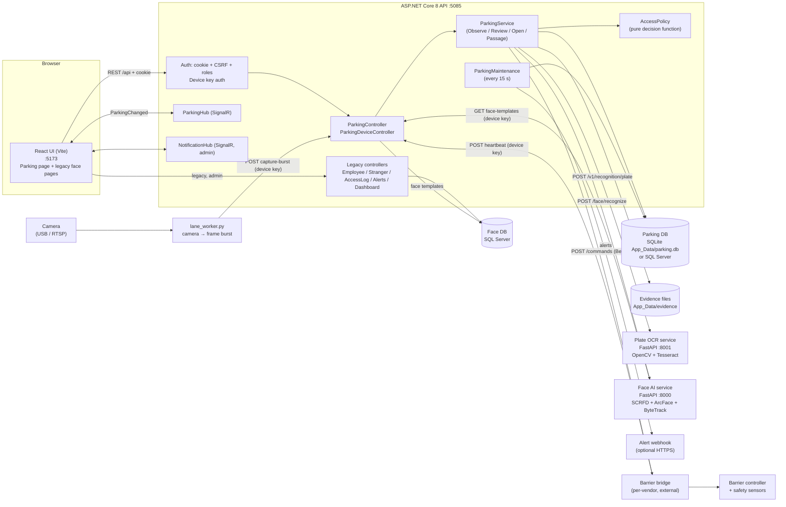
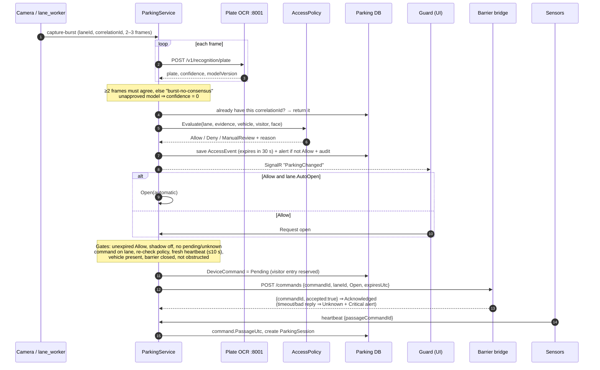
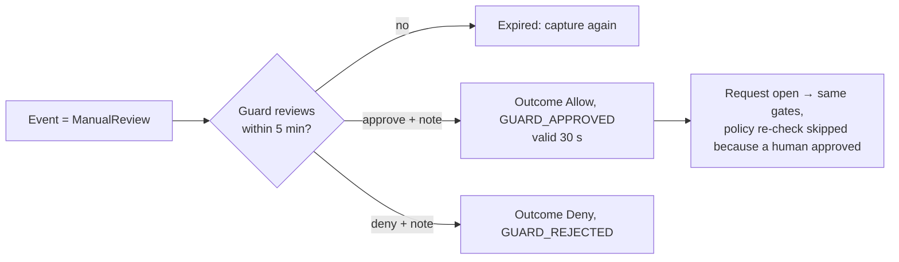
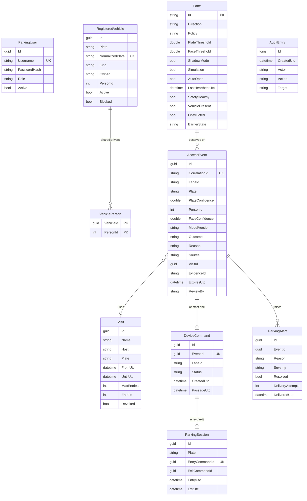
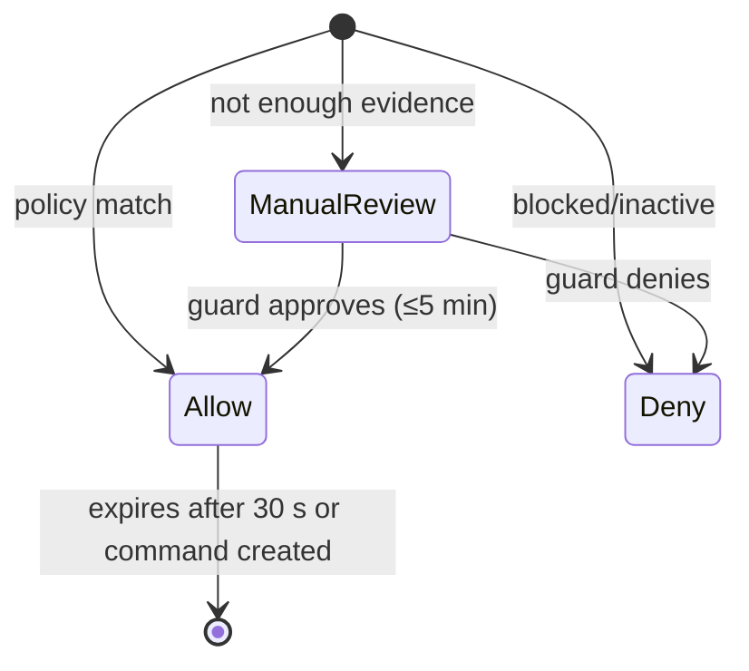
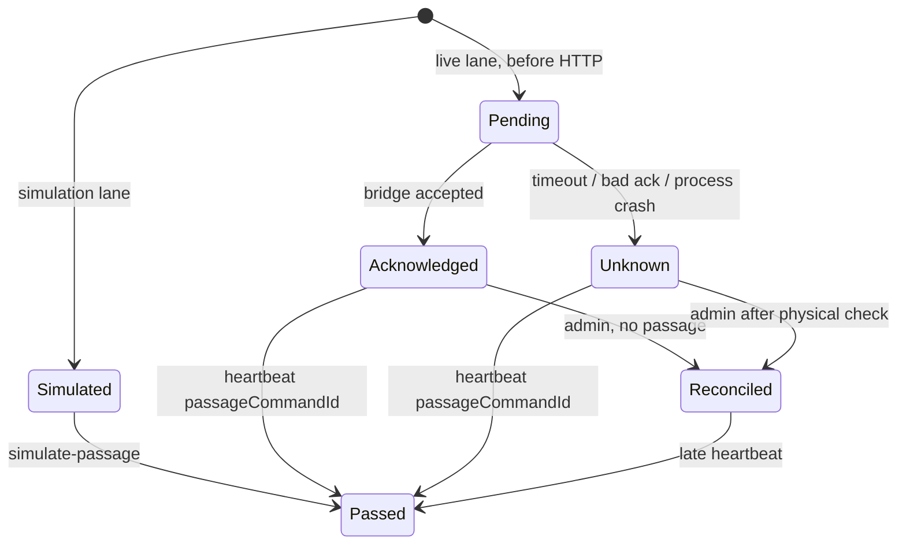

# Parking Access Management System — Project Overview

| Item | Value |
| --- | --- |
| Project | DSA Demo Bot Barrier App (repo: `FACERECOGNIZEAPP`) |
| Document type | System overview + bug log + change-request log |
| Last reviewed | 2026-09-24 (from source code, not from memory) |
| Owner | ThanhTranFPT-98 |
| Status of the software | Runnable locally in simulation/shadow mode; **not** commissioned on real cameras or barriers |

> **For AI agents:** read this whole file before changing code. Then check the [Bug log](#15-bug-log) for an entry that matches your error before you debug from scratch. When you fix something, add a bug entry. When the customer asks for something new, add a change request in [section 16](#16-change-request-log). Keep entries factual: say what was verified and what was assumed.

---

## Contents

1. [Purpose](#1-purpose)
2. [Scope](#2-scope)
    - [2A. General constraints (multi-project)](#2a-general-constraints-multi-project)
    - [2B. Site profile: Than Uông Bí – Tràng Bạch](#2b-site-profile-than-uông-bí--tràng-bạch)
3. [Users and roles](#3-users-and-roles)
4. [Glossary](#4-glossary)
5. [System architecture](#5-system-architecture)
6. [Components](#6-components)
7. [Features](#7-features)
8. [Main workflows](#8-main-workflows)
9. [Data model](#9-data-model)
10. [State machines](#10-state-machines)
11. [API summary](#11-api-summary)
12. [Security](#12-security)
13. [Configuration](#13-configuration)
14. [Run, test and troubleshoot](#14-run-test-and-troubleshoot)
15. [Bug log](#15-bug-log)
16. [Change request log](#16-change-request-log)
17. [Design limits, risks and open decisions](#17-design-limits-risks-and-open-decisions)
18. [Related documents](#18-related-documents)

---

## 1. Purpose

A web management application that controls vehicle access to a Vietnamese parking area (cars and motorcycles).

It must:

- Recognise **licence plates** (and optionally **faces**) from lane cameras.
- Decide **Allow / Deny / ManualReview** according to a per-lane policy.
- Let guards **review** uncertain cases and **request the barrier to open**.
- Track who is **inside** the car park (parking sessions) based on confirmed passage.
- Manage **registered vehicles**, **visitors**, **operators**, **alerts** and an **audit trail**.

Core principle, used throughout the code:

> **Recognition supplies evidence → the policy grants a short-lived authorisation → the barrier command consumes that authorisation once (idempotently) → a sensor confirms passage.**
> These are four separate facts. Never merge them.

The project started as a face-recognition attendance app (employees/strangers). The parking system was added on top as a separate bounded area with its own database.

## 2. Scope

### In scope

- Vietnamese civilian plate formats (one-line and two-line), cars and motorcycles.
- Five lane policies: `PlateOnly`, `FaceOnly`, `Either`, `Both`, `ManualReview`.
- Registered vehicles, shared drivers, blocking/deactivation.
- Visitor passes with time window and entry quota.
- Guard review with reason, expiry and audit.
- Barrier command through a generic HTTP bridge (plus simulation).
- Sensor heartbeat, passage confirmation, tailgating/safety/offline alerts.
- Parking sessions (entry → exit).
- Operator accounts with roles; audit; evidence images with retention.
- Legacy face subsystem (employees, strangers, access logs, face monitor) — admin only.

### Out of scope

- Parking fees / billing.
- PPE (helmet / clothing / boots) detection — excluded by decision 2026-09-24.
- Vendor-specific barrier drivers (a bridge must be built per controller).
- Physical safety (closing the arm, anti-crush) — belongs to the controller.
- Liveness/anti-spoofing for faces.
- Resident self-service portal, mobile app.
- Multi-server deployment (one API process per site).

### Planned, not built

- Receiver for third-party plate cameras (format in the `../tcp` capture). See `docs/THIRD_PARTY_CAMERA_PLAN.md`.

## 2A. General constraints (multi-project)

**Goal:** the product must serve **many customers and sites**, not only one. Each customer's needs are captured as a **site profile** (section 2B) made of *configuration*: areas, lanes, policies, vehicle categories, timings, language, retention. **Customer-specific rules must not be hard-coded.** If a new customer needs a new behaviour, add it as a configurable option that other sites can switch off.

Source: generalised from *Thuyết Minh Hệ Thống Than Uông Bí V2 17.9.26.docx* (`docs/`). PPE (safety-gear detection) is **excluded** by decision (2026-09-24).

**Status** compares each constraint with the current code, checked on 2026-09-24:
- ✅ **Met**
- 🟡 **Partial**
- ❌ **Missing**
- ⚠️ **Conflicts with the current design**

### Platform and architecture

| ID | Constraint | Status | Current state / gap |
| --- | --- | --- | --- |
| GC-01 | **Multi-site, multi-system on one platform.** Hierarchy *Area → Location → Lane/Camera*. Every screen, alert and report can be filtered by area. | ❌ | Lanes are a flat list; no Area/Location entity |
| GC-02 | **Two tiers: site station + central platform.** Each gate/lot runs locally; results sync to the central server (two-way). | ❌ | Single API process, one DB |
| GC-03 | **Keep working offline.** If the link to the centre drops, the site keeps operating in a configured local mode, buffers events and evidence, and syncs later **without losing data**. | ❌ | No sync/outbox |
| GC-04 | **Guard stations at the same gate sync peer-to-peer.** One PC failing must not stop the others. | ⚠️ | Current design is "one API process per site" with an in-process lock (section 17). Needs an architecture decision |
| GC-05 | **Vendor-neutral input.** Edge devices send one common message format, whatever the camera brand. Each brand gets an adapter. Existing RTSP/ONVIF cameras are reused. | 🟡 | Own OCR + lane worker only. Vendor adapter planned in `THIRD_PARTY_CAMERA_PLAN.md` |
| GC-06 | **Reuse the customer's existing devices and data**, e.g. face terminals that already hold enrolled workers, and existing barriers. Integrate their *outputs*; don't replace them. | ❌ | Face recognition is our own ArcFace service; no adapter for external face terminals |
| GC-07 | **Open integration API** for HR, access-control and production systems (push/pull events, people, vehicles). | 🟡 | REST exists, but only for our own UI; no documented external API or keys |
| GC-08 | **Scale without rewrite or downtime.** Add a camera, AI box, lane, area or user from the UI while the system is running. | 🟡 | Lanes and users can be added via UI; cameras, AI boxes and areas can't |
| GC-09 | **AI processing at the edge; only results go to the centre** (bandwidth). Video stream and event data travel on separate channels. | 🟡 | Our OCR is central; there's no concept of an edge box |

### Access workflow

| ID | Constraint | Status | Current state / gap |
| --- | --- | --- | --- |
| GC-10 | **Subjects: people and vehicles.** A lane may control people (turnstile/flap gate), vehicles (barrier) or person + vehicle. | 🟡 | Vehicle lanes only; face is used only as vehicle evidence |
| GC-11 | **Entry:** identify → check permission → auto-open **or** guard confirms → save event + images → open → sensor confirms passage → the controller closes. | ✅ | Matches the 8.1 flow. The overview image at the moment of passing isn't captured separately |
| GC-12 | **Exit is matched to the open entry session.** Show entry and exit images side by side. Mismatch, duplicate plate or missing data ⇒ opening is blocked and it goes to the guard. | 🟡 | Sessions match by plate; exit-without-entry only raises an alert (doesn't block); no side-by-side images |
| GC-13 | **Person–vehicle pairing** (configurable): the face and the plate must match the registered pair at entry **and** exit. | 🟡 | `Both` policy + shared drivers exist; exit isn't checked against the person who entered |
| GC-14 | **Every exception** (unreadable, no permission, unregistered, mismatch, duplicate, missing data) blocks automatic opening. The guard decides and the **reason + actor are logged**. | ✅ | Review flow with mandatory note + audit |
| GC-15 | **Vehicle categories with different rules:** registered, guest/visitor, delivery, unregistered. Permission has a **validity period**. | 🟡 | Registered + visitor only; vehicles have no category or expiry |
| GC-16 | **Walk-in registration at the gate:** a guard quickly registers an unknown vehicle for the day; it **expires automatically at the start of the next day** (configurable). | 🟡 | Visitor pass exists but needs a start/end time; no "today only" quick flow |
| GC-17 | **Optional inspection step on exit** (e.g. truck cargo check) with its own camera image, recorded **before** opening. Configurable per lane/category. | ❌ | Not supported |
| GC-18 | **Occupancy counting** (people underground, vehicles in lot) per shift. Counts are only valid when both directions are recorded, so missing passages must be surfaced. | 🟡 | Sessions exist; no occupancy view, no shift concept |
| GC-19 | **Overstay alert:** subject still inside after a configurable duration (e.g. one shift). | ❌ | Not supported |
| GC-20 | **Shifts:** configurable work shifts; search, stats and reports by shift. | ❌ | Not supported |
| GC-21 | **Physical safety stays in hardware.** The software never skips obstacle/loop checks and never sends a blind close. | ✅ | By design (`BARRIER_BRIDGE.md`) |

### Performance

| ID | Constraint | Status | Current state / gap |
| --- | --- | --- | --- |
| GC-22 | **Decision latency target per lane type:** the time from the subject reaching the camera to the open command. It's configurable and measured. Reference values: person 2–3 s, motorbike 3–5 s, car 4–6 s. | ❌ unmeasured | Burst capture (≤2 s) + Tesseract per frame (≤20 s timeout). Likely too slow. No latency metrics recorded |
| GC-23 | **Peak throughput:** the reference site has ~100 vehicles / 15 min across 2 lanes and ~2,000 registered vehicles. Must not cause queues. | ❌ unmeasured | A global lock serialises all decisions; no load test |
| GC-24 | **Temporal confirmation:** an object must be detected repeatedly before an alert is raised. Duplicates within a short window are merged. | 🟡 | 2-frame burst consensus; alert dedup only for some reasons |

### Alerts and monitoring

| ID | Constraint | Status | Current state / gap |
| --- | --- | --- | --- |
| GC-25 | **Alert lifecycle:** *Open → Acknowledged* (who/when) *→ Resolved* (**note mandatory**) or *False alarm*. False-alarm rate feeds AI tuning. | 🟡 | Only `Resolved` true/false, no note, no false-alarm state |
| GC-26 | **Every alert** has an ID, type, severity, time, area/lane, image **and video clip** evidence (with the detected box drawn). The UI shows it immediately with **colour by severity and sound**. | 🟡 | Image only, no clip, no sound; colour only on outcome tags |
| GC-27 | **Device health** for every camera, edge box, controller: periodic heartbeat; offline after a configurable timeout ⇒ alert. | 🟡 | Lane heartbeat only (30 s) |
| GC-28 | **Alert types are extensible** per site (unregistered vehicle, mismatch, overstay, intrusion zone, cargo, …). Per-camera sensitivity and confirmation time. | 🟡 | Reasons are free strings in code; no per-camera config |
| GC-29 | **Live video wall** (grid of RTSP streams, grouped by area) and camera status. | ❌ | Not supported (legacy Monitor uses the browser webcam only) |

### Data, evidence and reporting

| ID | Constraint | Status | Current state / gap |
| --- | --- | --- | --- |
| GC-30 | **Store images at every pass:** plate crop, overview, and optional inspection image. Keep them viewable and downloadable. | 🟡 | One evidence image per event |
| GC-31 | **Evidence integrity:** SHA-256 hash stored at capture, shown in reports. | ❌ | No hash |
| GC-32 | **Configurable retention** with automatic clean-up. | ✅ | `EvidenceRetentionDays` + worker |
| GC-33 | **Multi-criteria search:** time range / shift / day, area, lane/camera, event type, severity, status, plate/person. | 🟡 | Plate + time + page only |
| GC-34 | **Excel export** using the current filter. Reference layout has 5 sheets: Overview (who exported, filters, totals, false-alarm rate), Events, By area, Processing performance (mean/median/P95 of transfer time, time to acknowledge, time to close), Evidence (ID, size, SHA-256, retention). | ❌ | Not supported |
| GC-35 | **Statistics** by day / month / year / shift / area. | ❌ | Not supported for parking (legacy dashboard is face-only) |

### Users, security and deployment

| ID | Constraint | Status | Current state / gap |
| --- | --- | --- | --- |
| GC-36 | **Configurable roles.** Reference set: Viewer, Operator (guard), Safety officer (mark false alarms), Technician (cameras/areas/AI config), System admin. | 🟡 | Fixed Admin / Guard / Auditor |
| GC-37 | **Permissions are scoped by area** and accounts have an **expiry date**. | ❌ | Global roles, no expiry |
| GC-38 | **Audit** of login, configuration changes, alert handling, permission changes. | ✅ | `AuditEntry` (section 12) |
| GC-39 | **Browser-based, no install on the station; UI language configurable** (Vietnamese required for the reference site). | 🟡 | Browser ✅; UI is **English only** |
| GC-40 | **Remote access for managers over the Internet** behind a firewall with network segmentation, over HTTPS. | 🟡 | HTTPS/proxy guidance exists (`DEPLOYMENT.md`); not deployed |
| GC-41 | **Runs on modest hardware.** Reference station PC: Core i3/i5 12th gen, **8 GB RAM**, 256 GB SSD + 1 TB HDD, **Windows 11 Home**, no GPU. Heavy AI runs on a separate edge AI box. Central server: 12-core Xeon, 32 GB, large RAID. | ❓ | Not verified. PyTorch face service likely too heavy for the station PC |
| GC-42 | **Barrier control through a network I/O relay controller** (8 in / 8 out, web interface) plus loop detectors, i.e. the bridge in `BARRIER_BRIDGE.md` must support this class of device. | 🟡 | Generic HTTP bridge contract only; no relay adapter |
| GC-43 | Plate format rules per country/region are **configurable** (currently hard-coded Vietnamese regex in C# and Python). | 🟡 | Works for VN only |
| GC-44 | Timings are **configurable per site/lane**: decision validity 30 s, review window 5 min, lane cooldown 8 s, heartbeat 10/30 s. | ❌ | Hard-coded (section 13) |

### What this means for the design (for discussion — not decided)

- The biggest gaps are **structural**: GC-01 areas, GC-02/03/04 edge + central + sync, GC-06 external device adapters. They should be decided **before** adding features, because they change the data model and deployment.
- GC-04 (peer sync) **conflicts** with the current single-process safety model. The safe options are: (a) one primary station per gate with others as clients, or (b) a real distributed command-reservation protocol. This needs a decision.
- Many gaps are "make it configurable" (GC-15, 16, 20, 36, 43, 44). These are good candidates for a **site profile** config table rather than code branches.

## 2B. Site profile: Than Uông Bí – Tràng Bạch

The reference customer, from the same document (V2, 17/09/2026). These are **parameters**, not code. PPE items are omitted.

| Profile item | I. Main shaft entrance (Cửa lò Giếng chính) | II. Security gate MB +24 Tràng Khê | III. Motorbike parking lot |
| --- | --- | --- | --- |
| Subject | People (workers) | Cars + motorbikes | Motorbike + rider |
| Lanes | 6 flap-barrier lanes (reuse ZKTeco TH7621-S/T Plus) | 6: cars 2 in + 2 out, motorbikes 1 in + 1 out | 4: 2 in + 2 out (new) |
| Identification | Existing ZKTeco Face-S terminals (face/fingerprint, workers already enrolled) | Plate camera + overview camera per lane; Face ID on motorbike lanes (optional) | Rear plate camera + Face ID per lane; 2 overview cameras |
| Rule | Face ID valid **and** has permission ⇒ open | Registered plate ⇒ auto-open; otherwise guard. Exit matched to entry | Person–vehicle pair must match registration at entry **and** exit |
| Special flows | Count people underground per shift; overstay > one shift; data-mismatch alert | Walk-in day registration (expires at new day); guest/delivery rules; **cargo inspection camera on the 2 car exit lanes** | Walk-in vehicles, duplicate plates, info change handled by guard; fence-intrusion alert |
| Latency target | 2–3 s / person | Car 4–6 s, motorbike 4–5 s | 3–4 s / pass |
| Volume | 6 lanes, shift peaks | — (currently handwritten log book) | ~2,000 vehicles (1,500 fixed + 500 floating); avg 200 / 90 min; **peak 100 / 15 min** |
| Station hardware | i3-12100, 8 GB, Win 11 Home, 1 TB HDD, Asus AI Box 16 GB, network I/O controller ×2 | i5-12500, 8 GB, 2 monitors, AI Box, I/O controller, 6 loop detectors, UPS | i3-12100, 8 GB, AI Box, I/O controller, 4 loop detectors, 4 barriers |
| Link to centre | Existing fibre to the production control room | same | same |
| Central platform | Asus server (Xeon Silver 4510, 32 GB, 4×16 TB), Cisco firewall (≤50 users), 2×65″ video wall | ← shared | ← shared |
| Roles named | Admin, guard, manager, technician (+ viewer, safety officer in the platform section) | ← | ← |
| Language | Vietnamese | ← | ← |

Still unknown for this site: exact camera brand/firmware and message format (compare with `../tcp`), ZKTeco integration method (SDK / push / DB), shift times, retention period, overstay duration, and the latency measurement method.

## 3. Users and roles

| Role | Can do |
| --- | --- |
| **Admin** | Everything: vehicles, lanes, operators, reconcile commands, legacy face pages, audit |
| **Guard** | Lane monitor, simulate/capture, review, request open, visitors, acknowledge alerts, history |
| **Auditor** | Read-only: snapshot, history, audit |
| **Device** (machine) | Lane worker / barrier bridge: capture, capture-burst, heartbeat, face templates — via `X-Device-Key` |

## 4. Glossary

| Term | Meaning |
| --- | --- |
| **Lane** | One physical entry or exit point with a camera and a barrier (`entry-1`, `exit-1`). |
| **Observation / AccessEvent** | One recognition result on a lane plus the policy decision. |
| **CorrelationId** | Client-generated ID for an observation. Same ID sent twice = same event (retry-safe). |
| **Shadow mode** | Lane records decisions but will never open. Default ON. |
| **Simulation** | Lane uses fake hardware; commands become `Simulated`. Default ON. |
| **AutoOpen** | Lane opens automatically on an `Allow` camera event. Default OFF. |
| **DeviceCommand** | One request to open the barrier, tied 1:1 to an event. |
| **Passage** | Sensor-confirmed fact that the vehicle went through. |
| **ParkingSession** | Entry passage → exit passage for one plate. |
| **Reconcile** | Admin marks an `Unknown` command as checked physically. Never resends. |
| **Evidence** | Saved camera image for an event. |
| **Approved model** | `Parking:ApprovedPlateModel`. If OCR model version ≠ this, its confidence is forced to 0 → review. |

## 5. System architecture

### 5.1 Component diagram



### 5.2 Layers

```text
Presentation   ui/src/pages/Parking/Parking.jsx (tabs), AuthContext, MainLayout
API            ParkingCore/ParkingController.cs, Security.cs (auth endpoints)
Domain logic   ParkingCore/ParkingService.cs, Domain.cs (AccessPolicy, VietnamPlate)
Persistence    ParkingCore/Domain.cs (ParkingDb, EF Core), Migrations + SqlServerMigrations
Background     ParkingCore/Maintenance.cs (offline alerts, retention, webhook)
AI services    AiService/plate_service.py, AiService/app/main.py, AiService/lane_worker.py
```

## 6. Components

| Component | Path | Tech | Port | Notes |
| --- | --- | --- | --- | --- |
| Web UI | `ui/` | React 18, Vite 8, Ant Design, axios, SignalR | 5173 | Vite proxies `/api`, `/parkingHub`, `/notificationHub` to 5085 |
| API | `MyfirstASP_NET/` | ASP.NET Core 8, EF Core, SignalR | 5085 | Entry: `Program.cs` → `builder.AddParking()` in `ParkingCore/Setup.cs` |
| Parking core | `MyfirstASP_NET/ParkingCore/` | C# | — | All parking logic lives here |
| Old simulation | `MyfirstASP_NET/Parking/ParkingSimulation.cs` | C# | — | In-memory demo, kept only for its tests |
| Legacy face backend | `MyfirstASP_NET/Controllers`, `Services`, `Repository`, `Models` | C# + SQL Server | — | Employees/strangers/access logs. Admin only |
| Plate OCR | `AiService/plate_service.py` | FastAPI, OpenCV, Tesseract | 8001 | Baseline, **uncalibrated** (`calibrated: false`) |
| Face AI | `AiService/app/main.py` | FastAPI, PyTorch, SCRFD, ArcFace | 8000 | Needs model weights (not in repo) |
| Lane worker | `AiService/lane_worker.py` | Python, OpenCV, requests | — | Sends 2–3 frame bursts per interval |
| Plate evaluation | `AiService/evaluate_plates.py` | Python | — | Measures OCR accuracy on a labelled manifest |
| Backup | `scripts/backup_sqlite.py` | Python | — | Online SQLite backup |
| Launcher | `scripts/Start-Parking.ps1` | PowerShell | — | Use this one (not `start-all.bat`) |
| Tests | `tests/` | C# console tests + Python | — | See section 14 |

## 7. Features

| # | Feature | Where (backend / UI tab) |
| --- | --- | --- |
| F1 | Sign in / out, CSRF, roles, rate-limited login (10/min/IP) | `Security.cs` / login screen |
| F2 | Operator accounts (create, list, deactivate non-admin) | `api/auth/users` / *Operators* |
| F3 | Vehicle registration, shared drivers, activate/block | `vehicles` / *Vehicles* |
| F4 | Visitor passes (window + max entries), revoke | `visits` / *Visitors* |
| F5 | Lane configuration (direction, policy, thresholds, shadow, simulation, autoOpen) | `lanes` / *Lane settings* |
| F6 | Simulated observation | `simulate` / *Lane monitor* |
| F7 | Camera image upload → OCR (+ optional face) → decision | `recognize` / *Lane monitor* |
| F8 | Lane worker bursts with 2-frame consensus | `device/capture-burst` |
| F9 | Guard review (approve/deny + reason, 5 min window) | `events/{id}/review` / modal |
| F10 | Request open (all safety gates) + AutoOpen | `events/{id}/open` |
| F11 | Sensor heartbeat, passage, tailgating, safety fault | `device/heartbeat` |
| F12 | Parking sessions (entry/exit) | *Lane monitor* table |
| F13 | Alerts + acknowledge + webhook delivery with retry | *Alerts* |
| F14 | Reconcile unknown/unfinished commands | *Lane monitor* (admin) |
| F15 | History search, audit log, evidence view (audited) | *History & audit* |
| F16 | Device health (DB, OCR, heartbeat state) | *Device health* |
| F17 | Evidence retention worker | `Maintenance.cs` |
| F18 | Legacy: face monitor, employees, strangers, access logs, dashboard | legacy pages (admin) |

## 8. Main workflows

### 8.1 Vehicle entry (happy path)



### 8.2 Manual review



### 8.3 Exit

Same as entry on an `Exit` lane. A plate with an open session counts as authorised for exit even without a visitor pass. Confirmed exit passage closes the newest open session. Exit without an open session raises `EXIT_WITHOUT_ENTRY`.

### 8.4 Policy decision (`AccessPolicy.Evaluate` in `Domain.cs`)

```text
blocked vehicle                         → Deny  BLOCKED_VEHICLE
inactive vehicle                        → Deny  INACTIVE_VEHICLE
score NaN / outside 0..1                → Review INVALID_SCORES
plateOK = common VN format AND conf ≥ lane.PlateThreshold AND (active vehicle OR visitor/inside)
faceOK  = face authorisation on AND personId AND conf ≥ lane.FaceThreshold
faceOK but person ≠ vehicle owner       → Review PERSON_VEHICLE_CONFLICT
policy: PlateOnly=plateOK | FaceOnly=faceOK | Either=plateOK||faceOK | Both=plateOK&&faceOK&&same person
allowed → Allow (POLICY_MATCH / ACTIVE_VISITOR), else Review (INSUFFICIENT_IDENTITY_EVIDENCE / GUARD_APPROVAL_REQUIRED)
```

## 9. Data model

Parking database (`ParkingDb`, SQLite by default). Separate from the face database.



Notes:

- Relations shown in the diagram are **logical**. Only `VehiclePerson → RegisteredVehicle` is a real foreign key. The others are matched by ID or by plate string in code.
- `PersonId` refers to `People.Id` in the **face** database (another DB, so there is no FK).
- Unique indexes enforce idempotency: `CorrelationId`, `DeviceCommand.EventId`, `ParkingSession.EntryCommandId`.
- Face DB (legacy, SQL Server): `People` (base) → `Employee`, `Stranger`; `Embedding` (vector, encrypted with Data Protection when written); `AccessLog`.

## 10. State machines

### AccessEvent.Outcome



### DeviceCommand.Status



"Passed" is not a status value: it means `PassageUtc` is set. While a lane has a command that is `Unknown`, `Pending`, or `Acknowledged` without passage, **no new command is allowed on that lane**. The same applies for 8 s after any command.

## 11. API summary

Base URL: `http://localhost:5085`. Every non-GET `/api` call needs the `X-CSRF-Token` header (from `GET /api/auth/csrf`), except `/api/v1/parking/device/*`.

| Method | Path | Role |
| --- | --- | --- |
| GET | `/api/auth/csrf` | anonymous |
| POST | `/api/auth/login` · `/api/auth/logout` | anonymous · any |
| GET | `/api/auth/me` | any |
| GET/POST | `/api/auth/users`, POST `/api/auth/users/{id}/deactivate` | Admin |
| GET | `/api/v1/parking/snapshot` | Admin, Guard, Auditor |
| GET | `/api/v1/parking/events?plate&from&until&page` | Admin, Guard, Auditor |
| GET | `/api/v1/parking/audit?page` | Admin, Auditor |
| GET | `/api/v1/parking/health` | Admin, Guard, Auditor |
| POST/PUT | `/api/v1/parking/vehicles`, `/vehicles/{id}` | Admin |
| POST | `/api/v1/parking/visits`, `/visits/{id}/revoke` | Admin, Guard |
| PUT | `/api/v1/parking/lanes` | Admin |
| POST | `/api/v1/parking/simulate` | Admin, Guard |
| POST | `/api/v1/parking/recognize` (multipart: laneId, correlationId, image, face?) | Admin, Guard |
| POST | `/api/v1/parking/events/{id}/review` · `/events/{id}/open` | Admin, Guard |
| GET | `/api/v1/parking/events/{id}/evidence` | Admin, Guard |
| POST | `/api/v1/parking/alerts/{id}/resolve` | Admin, Guard |
| POST | `/api/v1/parking/commands/{id}/reconcile` | Admin |
| POST | `/api/v1/parking/commands/{id}/simulate-passage` | Admin, Guard |
| POST | `/api/v1/parking/device/capture`, `/capture-burst`, `/heartbeat` | Device key |
| GET | `/api/v1/parking/device/face-templates` | Device key |
| — | `/api/Employee`, `/api/Stranger`, `/api/AccessLog`, `/api/Alerts`, `/api/Dashboard`, `/api/embeddings`, `/api/FaceRecognize` | Admin (legacy) |
| WS | `/parkingHub` (event `ParkingChanged`) · `/notificationHub` | staff · Admin |

Error convention in `ParkingController`: business rule broken → **409** `{message}`; AI unreachable → **503**; AI timeout → **504**; CSRF invalid → **400**.

## 12. Security

- Cookie `parking-session`: HttpOnly, SameSite=Strict, 8 h lifetime. The cookie is re-validated against the DB on every request, so a deactivated user is signed out immediately.
- Passwords hashed with ASP.NET `PasswordHasher`; minimum length 12; no default password (bootstrap via `Parking__BootstrapPassword`).
- CSRF middleware on all mutating `/api` calls (except device routes).
- Fallback policy: every endpoint requires authentication unless `[AllowAnonymous]`.
- Device auth: constant-time compare of SHA-256 of `X-Device-Key` vs `Parking:DeviceKey` (≥32 chars).
- Legacy `/api/*` and `/snapshots` are forced to Admin by middleware.
- Face templates are encrypted with Data Protection when written. **Back up the key ring**: without it, encrypted templates can't be read.
- Evidence served only through an audited endpoint with `no-store`.
- AI services must stay on loopback or an internal network (no auth on them).

## 13. Configuration

Set these through environment variables (`__` = section separator) or user-secrets. Full table in `docs/DEPLOYMENT.md`.

| Key | Default | Purpose |
| --- | --- | --- |
| `Parking__BootstrapPassword` | — | First admin (only when the user table is empty) |
| `Parking__Provider` | SQLite | `SqlServer` switches context + migrations |
| `ConnectionStrings__Parking` | `App_Data/parking.db` | Parking DB |
| `ConnectionStrings__DefaultConnection` | placeholder | Legacy face DB (SQL Server) |
| `Parking__PlateAiUrl` / `Parking__FaceAiUrl` | `127.0.0.1:8001` / `:8000` | AI services |
| `Parking__ApprovedPlateModel` | empty | Empty ⇒ all OCR goes to review |
| `Parking__EnableFaceAuthorization` | false | Face scores are ignored unless true |
| `Parking__DeviceKey` / env `PARKING_DEVICE_KEY` | — | Device credential |
| `Parking__EnableLiveBarrier`, `Parking__BarrierUrl`, `Parking__BarrierKey` | off | Real barrier |
| `Parking__AlertWebhookUrl`, `Parking__AlertWebhookKey` | — | HTTPS alerts |
| `Parking__EvidenceRetentionDays` | 0 (keep) | Auto-delete evidence |
| `TESSERACT_CMD` | `tesseract` | OCR executable |

Timing constants (hard-coded, `ParkingService.cs` / `Maintenance.cs`): decision valid 30 s · review window 5 min · lane cooldown 8 s · heartbeat freshness 10 s · offline alert 30 s · maintenance tick 15 s · AI timeout 20 s · device HTTP timeout 5 s.

## 14. Run, test and troubleshoot

### Run (local, simulation)

```powershell
# from FACERECOGNIZEAPP
cd ui; npm ci; cd ..
python -m pip install -r AiService/requirements-plate.txt   # + install Tesseract
.\scripts\Start-Parking.ps1 -Bootstrap                       # first time only; asks admin password
# open http://localhost:5173/parking  (user: admin)
```

Logs: `MyfirstASP_NET/App_Data/parking-api*.log`, `parking-ocr*.log`. Demo flow: `docs/DEPLOYMENT.md` → "Demo flow".

### Tests

```powershell
dotnet run --project tests/ParkingCore.Tests
dotnet run --project tests/ParkingSimulation.Tests
python tests/integration_parking.py          # needs Debug build of API
python -m unittest discover -s AiService -p test_plate_service.py -v
python -m unittest discover -s tests -p test_backup.py -v
```

### Environment on this machine (checked 2026-09-24)

| Tool | Present |
| --- | --- |
| dotnet | yes (`C:\Program Files\dotnet`) |
| node | yes |
| python | 3.12 |
| tesseract | **no** |
| Face model weights (`arcface_r50.pth`, `scrfd_2.5g_bnkps.onnx`) | **no** |

### Quick diagnosis

| Symptom | Likely cause |
| --- | --- |
| API exits at startup: "Set Parking__BootstrapPassword" | Empty user table and no bootstrap password → run the launcher with `-Bootstrap` |
| Every POST returns 400 "Invalid CSRF token" | Cookie lost / different origin → reload, sign in again, use :5173 via the Vite proxy |
| 401 on everything | Not signed in or cookie expired (8 h) |
| 403 on `/api/Employee` etc. | Not an Admin (legacy APIs are admin-only by design) |
| Recognize → 503 | OCR service down or Tesseract missing (`/health` returns 503) |
| Every camera event is ManualReview | `ApprovedPlateModel` empty (by design) |
| Open → 409 "Shadow mode…" | Lane shadow mode ON |
| Open → 409 "recent or unresolved command" | Command on lane is Unknown/Pending/Acknowledged-without-passage, or <8 s since the last one → pass or reconcile |
| Open → 409 "Fresh healthy sensor feedback…" | Live lane without a heartbeat in the last 10 s |
| Review → 409 "Review expired" | More than 5 min since the event |

---

## 15. Bug log

**How to use:** add new bugs at the top of the table and a detail block below it. Before debugging an error, search this section for the error text. Status values: `Open`, `In progress`, `Fixed`, `Won't fix`, `By design`.

| ID | Date | Title | Area | Severity | Status |
| --- | --- | --- | --- | --- | --- |
| BUG-006 | 2026-09-24 | Invalid webhook URL throws on every maintenance tick | Backend / Maintenance | Low | Open |
| BUG-005 | 2026-09-24 | Face model weights missing | Env / AiService | Medium | Open |
| BUG-004 | 2026-09-24 | Tesseract not installed → plate OCR 503 | Env / AiService | High | Open |
| BUG-003 | 2026-09-24 | Face camera worker posts to non-existent endpoint | AiService ↔ API | Medium | Open |
| BUG-002 | 2026-09-24 | `start-all.bat` has hard-coded paths and predates parking auth | Scripts | Medium | Open |
| BUG-001 | 2026-09-24 | Entire parking subsystem is untracked in git | Repo | **Critical** | Open |

### Entry template (copy for each new bug)

```markdown
### BUG-XXX — <short title>
- **Date found / fixed:** YYYY-MM-DD / YYYY-MM-DD
- **Found by:** <person or agent>
- **Area / files:** <component, file:line>
- **Severity:** Critical | High | Medium | Low
- **Status:** Open | In progress | Fixed | Won't fix | By design
- **Symptom (exact error text / screenshot):**
- **Steps to reproduce:**
- **Expected vs actual:**
- **Root cause (why it happened):**
- **Fix (what changed, and why this fix):**
- **Verification (test/command that proves it):**
- **How to recognise it again:** <error signature an agent can grep for>
- **Related:** <BUG/CR IDs>
```

### BUG-001 — Entire parking subsystem is untracked in git
- **Date found:** 2026-09-24 · **Found by:** agent code review
- **Area / files:** `MyfirstASP_NET/ParkingCore/`, `MyfirstASP_NET/Parking/`, `AiService/plate_service.py`, `lane_worker.py`, `evaluate_plates.py`, `ui/src/pages/Parking/`, `ui/src/contexts/AuthContext.jsx`, `docs/`, `scripts/`, `tests/`, `PARKING_IMPLEMENTATION.md`. Tracked files such as `Program.cs` also have uncommitted edits.
- **Severity:** Critical · **Status:** Open
- **Symptom:** `git status` shows these paths as `??`. Git history has only 2 commits, both from the original face app.
- **Root cause:** Work was done but never committed.
- **Risk:** One disk failure or a `git clean` / `git checkout .` loses the whole parking app. `Program.cs` already depends on `ParkingCore`, so the committed version doesn't match the files on disk.
- **Fix:** Create a branch and commit (check `.gitignore` excludes `App_Data/*.db`, `App_Data/evidence`, logs and keys first). Push to a remote.
- **How to recognise again:** `git status --short | grep '^??'` lists source folders.

### BUG-002 — `start-all.bat` has hard-coded paths and predates parking auth
- **Area / files:** `start-all.bat`
- **Severity:** Medium · **Status:** Open
- **Symptom:** Windows open and fail with "Cannot find path 'D:\Tran_Thanh\Self_learning\CSharp\FaceRecognizeApp\…'".
- **Root cause:** Paths from the original developer's machine. The script also doesn't start the plate OCR (:8001) and doesn't handle the bootstrap password.
- **Fix:** Use `scripts/Start-Parking.ps1`. Either delete `start-all.bat` or rewrite it to use `%~dp0` relative paths.
- **How to recognise again:** Error text contains `D:\Tran_Thanh`.

### BUG-003 — Face camera worker posts to non-existent endpoint
- **Area / files:** `AiService/app/main.py:31` (`ASP_NET_API_URL = ".../api/face-events/receive-ai-result"`), used by `send_result_to_aspnet` / `camera_worker`.
- **Severity:** Medium · **Status:** Open
- **Symptom (expected):** Results from `POST /camera/start` never reach the API (404; and after the auth changes it would get 401/400 CSRF anyway).
- **Root cause:** No controller maps `api/face-events`. The route was probably renamed or never built. The call also has no cookie/CSRF/device key.
- **Fix options:** (a) remove the server-side camera worker path and keep the browser Monitor flow (`/api/FaceRecognize/RecognizeFrame`); (b) add a device-authenticated endpoint under `/api/v1/parking/device/…`. Needs a decision.
- **How to recognise again:** Log line from `send_result_to_aspnet` with 404/401 against `face-events`.

### BUG-004 — Tesseract not installed → plate OCR 503
- **Area:** environment; `AiService/plate_service.py` `tesseract_path()`
- **Severity:** High (for camera-based features) · **Status:** Open
- **Symptom:** `/health` on :8001 returns 503 `{"ready": false}`. Recognize returns 503 "Tesseract is not installed. Set TESSERACT_CMD…". The UI shows "Recognition service is unavailable".
- **Fix:** Install Tesseract (UB Mannheim build on Windows) with English data. Set `TESSERACT_CMD` if it isn't on PATH.
- **How to recognise again:** Error text `Tesseract is not installed`.

### BUG-005 — Face model weights missing
- **Area:** `AiService/face_recognition/arcface/weights/`, `AiService/face_detection/scrfd/weights/` (only README present)
- **Severity:** Medium · **Status:** Open
- **Symptom:** Face service (:8000) fails at model load. Face policies and legacy Monitor don't work.
- **Fix:** Obtain `arcface_r50.pth` and `scrfd_2.5g_bnkps.onnx` (see `README.md`). Check the licences.

### BUG-006 — Invalid webhook URL throws on every maintenance tick
- **Area / files:** `MyfirstASP_NET/ParkingCore/Maintenance.cs:51-53`
- **Severity:** Low · **Status:** Open (found by code reading, not reproduced)
- **Symptom (expected):** If `Parking__AlertWebhookUrl` is set to an `http://` URL, "Parking maintenance failed … Alert webhook must use HTTPS" is logged every 15 s. Offline/retention work before it still runs.
- **Fix idea:** Validate at startup and fail fast, or log once.

---

## 16. Change request log

Use this section for the customer's new requirements. Write an entry **before** you code, so the design reasoning is recorded.

| ID | Date | Requested by | Title | Priority | Status |
| --- | --- | --- | --- | --- | --- |
| CR-001 | 2026-09-24 | Than Uông Bí (via ThanhTranFPT-98) | Store data in the cloud now; central platform deferred | High | Proposed — questions open |

### CR-001 — Store data in the cloud now; central platform deferred
- **Date / requested by:** 2026-09-24, Than Uông Bí (reported by ThanhTranFPT-98)
- **Requirement (as reported):** The customer will **not** build the central server/platform now. They want the site data saved **in the cloud** for now, and will build the central platform in the future.
- **Interpretation (draft, to confirm):** Site stations keep running locally (GC-02/03). Instead of syncing to an on-premise central server, they sync events + evidence to cloud storage. Later the central platform should be able to read/import that data, so the sync format must be the vendor-neutral common format (GC-05), not something tied to one cloud.
- **Open questions:**
  1. Which cloud and service? (e.g. customer's own cloud account, a Vietnamese provider, Azure/AWS/Google; database vs file storage)
  2. What must go to the cloud? Events only, or also images (plate/overview) and video? How long is it kept there?
  3. Must the gate keep working when the Internet is down? (Assumed **yes**, GC-03.)
  4. Who reads the cloud data before the central platform exists: nobody (backup only), managers via a web page, or reports?
  5. Any rule about where data may be stored (inside Vietnam, company-owned only)? Workers' faces are personal data.
- **Impacted components (expected):** new outbox table + sync worker in the API, evidence upload, configuration for cloud credentials, docs.
- **Status:** Proposed

### Entry template

```markdown
### CR-XXX — <title>
- **Date / requested by:**
- **Requirement (customer's words):**
- **Interpretation (what we will build) + questions asked/answered:**
- **Acceptance criteria:** (testable bullet list)
- **Impacted components:** UI tab / controller / service / DB migration / AI / docs
- **Design decision and why; alternatives rejected:**
- **Risks / edge cases:**
- **DB migration needed?** yes/no — remember both `Migrations` (SQLite) and `SqlServerMigrations`
- **Status:** Proposed | Approved | In progress | Done | Rejected
- **Result / verification:**
```

### Checklist when changing the system

- [ ] Entity changed → add EF migrations for **both** providers (`ParkingDb` and `ParkingSqlServerDb`).
- [ ] New mutating endpoint → goes under `/api/v1/parking`, has a role `[Authorize]`, calls `db.Log(...)` (audit), and uses `Mutate(...)` or `mutex.Gate` if it touches lanes/commands/events.
- [ ] New camera/AI input → goes through `ParkingService.Observe`, never straight to `Open`.
- [ ] Anything that opens a barrier → must keep every gate in `Open()` (section 8.1).
- [ ] UI → role-gated (`admin` / `operator` flags in `Parking.jsx`).
- [ ] Update this file: features table, API table, bug/CR log.
- [ ] Run the tests in section 14.

## 17. Design limits, risks and open decisions

**Limits (by design):**

- One API process per site. `ParkingLock` is an in-process semaphore, not a distributed lock.
- All state-changing parking operations are serialised by one global lock. That's simple and safe, but throughput is limited.
- A visitor entry is spent when opening is *requested*, even if the barrier outcome is unknown.
- The audit log is append-only through the app only. A DBA can still change it.
- OCR is a baseline with no measured accuracy.
- There is no liveness check, so face authorisation is off by default.
- `EXIT_WITHOUT_ENTRY` / `DUPLICATE_ENTRY` produce alerts and don't block.

**Risks:**

- Uncommitted code (BUG-001).
- Losing the Data Protection key ring makes the encrypted face templates unreadable.
- Hard-coded timings may not fit the real lane speed.
- The plate regex covers civilian formats only. Special plates always go to review.

**Open decisions (from `LEARNING_CHECKLIST.md`):** exact entry/exit rules; camera vendor/firmware and number of lanes; camera-plate-only vs fallback OCR; traffic targets; hardware; retention/legal requirements; UI channels (web/mobile/guard station).

## 18. Related documents

- `README.md` — original face-recognition app
- `PARKING_IMPLEMENTATION.md` — delivery status per stage
- `docs/DEPLOYMENT.md` — setup, configuration, demo flow
- `docs/BARRIER_BRIDGE.md` — bridge contract
- `docs/PILOT_RUNBOOK.md` — commissioning, rollback, backup
- `docs/THIRD_PARTY_CAMERA_PLAN.md` — third-party camera integration plan (Vietnamese)
- `../PARKING_ACCESS_DEVELOPMENT_PLAN.html` — original development plan
- `../LEARNING_CHECKLIST.md` — understanding checklist
