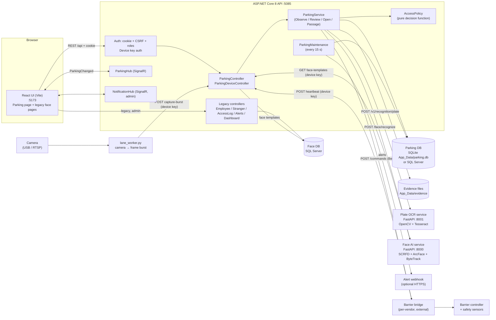
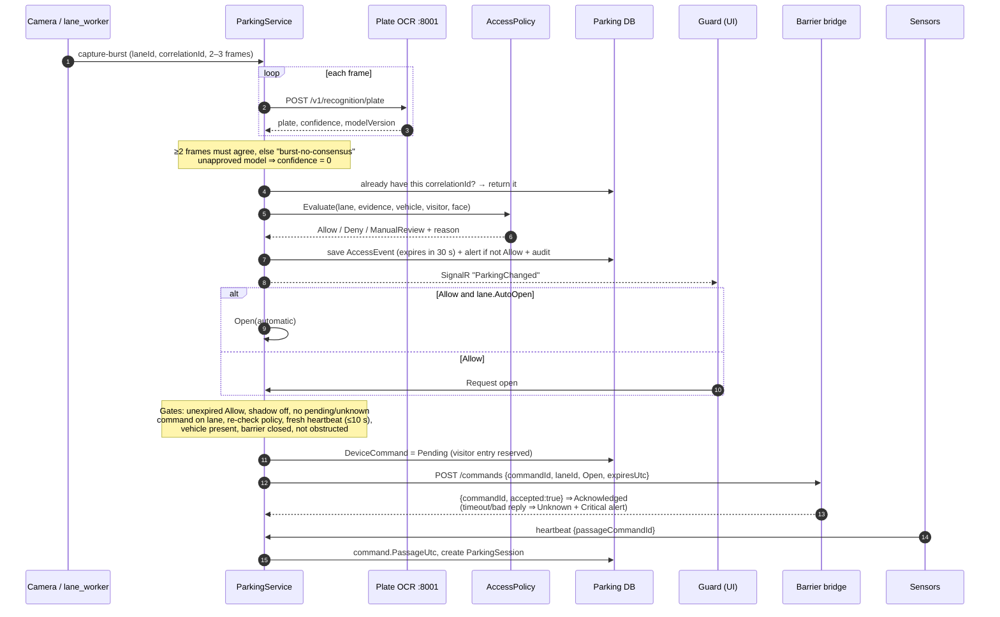
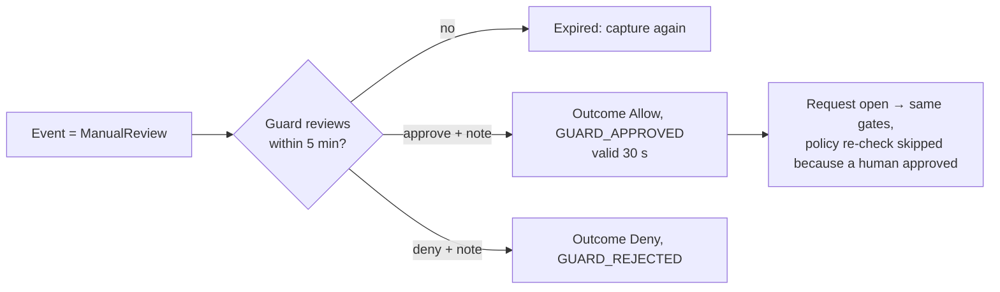
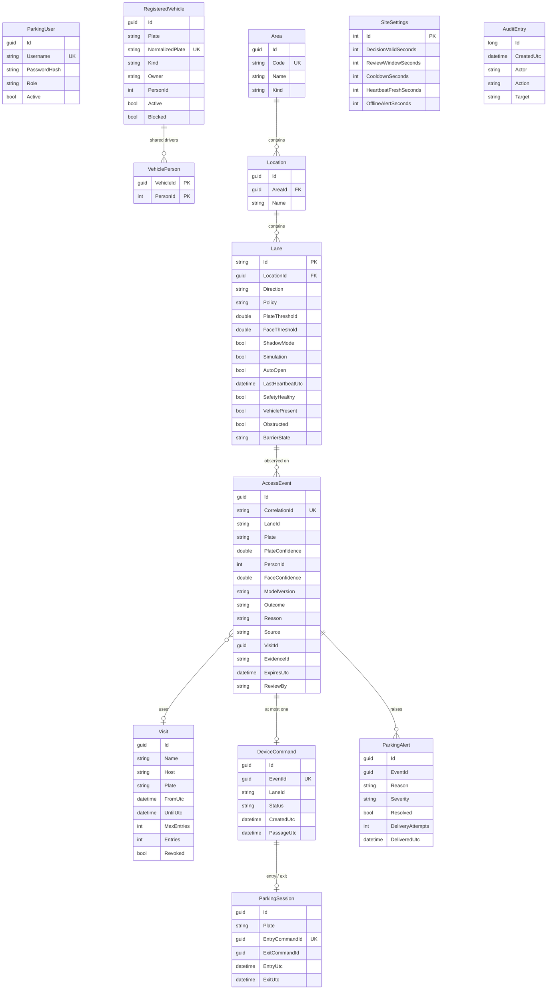
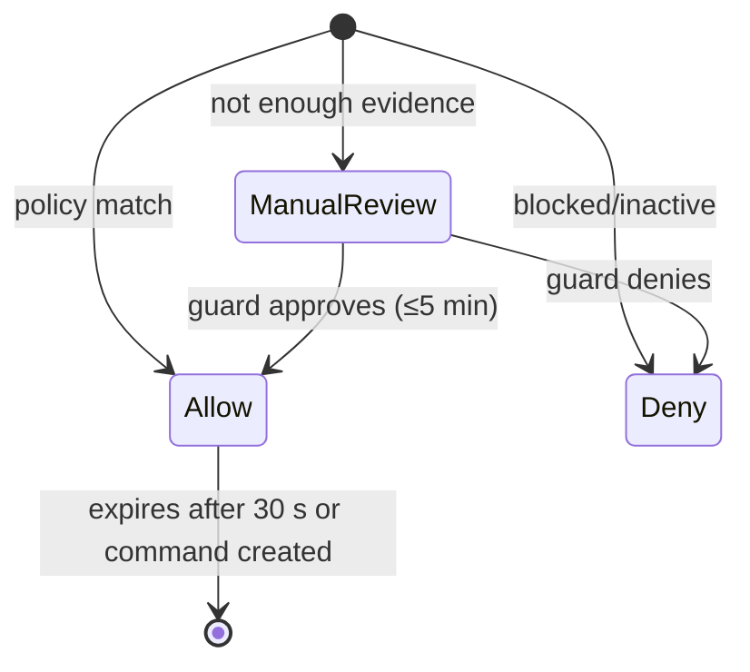
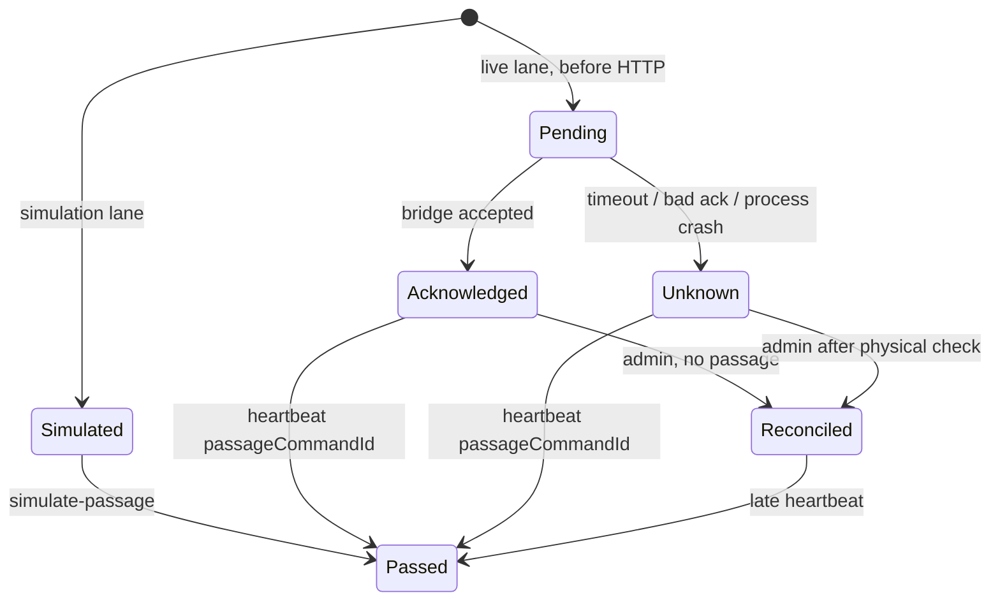

# Parking Access Management System — Project Overview

| Item | Value |
| --- | --- |
| Project | DSA Vehicle (repo: `DSA_Vehicle`) |
| Document type | System overview + bug log + change-request log |
| Last reviewed | 2026-09-24 (from source code, not from memory) |
| Owner | ThanhTranFPT-98 |
| Status of the software | Runnable locally in simulation/shadow mode; **not** commissioned on real cameras or barriers |

> **For AI agents:** read this whole file before changing code. Then check the [Bug log](#15-bug-log) for an entry that matches your error before you debug from scratch. When you fix something, add a bug entry. When the customer asks for something new, add a change request in [section 16](#16-change-request-log). Keep entries factual: say what was verified and what was assumed.

---

## Contents

1. [Purpose](#1-purpose)
2. [Scope](#2-scope)
    - [2A. General constraints (multi-project)](#2a-general-constraints-multi-project)
    - [2B. Site profile: Than Uông Bí – Tràng Bạch](#2b-site-profile-than-uông-bí--tràng-bạch)
3. [Users and roles](#3-users-and-roles)
4. [Glossary](#4-glossary)
5. [System architecture](#5-system-architecture)
6. [Components](#6-components)
7. [Features](#7-features)
8. [Main workflows](#8-main-workflows)
9. [Data model](#9-data-model)
10. [State machines](#10-state-machines)
11. [API summary](#11-api-summary)
12. [Security](#12-security)
13. [Configuration](#13-configuration)
14. [Run, test and troubleshoot](#14-run-test-and-troubleshoot)
15. [Bug log](#15-bug-log)
16. [Change request log](#16-change-request-log)
17. [Design limits, risks and open decisions](#17-design-limits-risks-and-open-decisions)
18. [Related documents](#18-related-documents)

---

## 1. Purpose

A web management application that controls vehicle access to a Vietnamese parking area (cars and motorcycles).

It must:

- Recognise **licence plates** (and optionally **faces**) from lane cameras.
- Decide **Allow / Deny / ManualReview** according to a per-lane policy.
- Let guards **review** uncertain cases and **request the barrier to open**.
- Track who is **inside** the car park (parking sessions) based on confirmed passage.
- Manage **registered vehicles**, **visitors**, **operators**, **alerts** and an **audit trail**.

Core principle, used throughout the code:

> **Recognition supplies evidence → the policy grants a short-lived authorisation → the barrier command consumes that authorisation once (idempotently) → a sensor confirms passage.**
> These are four separate facts. Never merge them.

The project started as a face-recognition attendance app (employees/strangers). The parking system was added on top as a separate bounded area with its own database.

## 2. Scope

### In scope

- Vietnamese civilian plate formats (one-line and two-line), cars and motorcycles.
- Five lane policies: `PlateOnly`, `FaceOnly`, `Either`, `Both`, `ManualReview`.
- Registered vehicles, shared drivers, blocking/deactivation.
- Visitor passes with time window and entry quota.
- Guard review with reason, expiry and audit.
- Barrier command through a generic HTTP bridge (plus simulation).
- Sensor heartbeat, passage confirmation, tailgating/safety/offline alerts.
- Parking sessions (entry → exit).
- Operator accounts with roles; audit; evidence images with retention.
- Legacy face subsystem (employees, strangers, access logs, face monitor) — admin only.

### Out of scope

- Parking fees / billing.
- PPE (helmet / clothing / boots) detection — excluded by decision 2026-09-24.
- Vendor-specific barrier drivers (a bridge must be built per controller).
- Physical safety (closing the arm, anti-crush) — belongs to the controller.
- Liveness/anti-spoofing for faces.
- Resident self-service portal, mobile app.
- Multi-server deployment (one API process per site).

### Planned, not built

- Receiver for third-party plate cameras (format in the `../tcp` capture). See `docs/THIRD_PARTY_CAMERA_PLAN.md`. *Built in CR-007; configurable device profiles in CR-015 (`docs/DEVICE_INPUT.md`).*
- 

## 2A. General constraints (multi-project)

**Goal:** the product must serve **many customers and sites**, not only one. Each customer's needs are captured as a **site profile** (section 2B) made of *configuration*: areas, lanes, policies, vehicle categories, timings, language, retention. **Customer-specific rules must not be hard-coded.** If a new customer needs a new behaviour, add it as a configurable option that other sites can switch off.

Source: generalised from *Thuyết Minh Hệ Thống Than Uông Bí V2 17.9.26.docx* (`docs/`). PPE (safety-gear detection) is **excluded** by decision (2026-09-24).

**Status** compares each constraint with the current code, checked on 2026-09-24:
- ✅ **Met**
- 🟡 **Partial**
- ❌ **Missing**
- ⚠️ **Conflicts with the current design**

### Platform and architecture

| ID | Constraint | Status | Current state / gap |
| --- | --- | --- | --- |
| GC-01 | **Multi-site, multi-system on one platform.** Hierarchy *Area → Location → Lane/Camera*. Every screen, alert and report can be filtered by area. | ✅ | CR-002 areas/locations; CR-005 accounts limited by area; CR-012 search, stats and Excel filter by area | 
Note for contraint: We need to design Area, location field in the DB 
| GC-02 | **Two tiers: site station + central platform.** Each gate/lot runs locally; results sync to the central server (two-way). | 🟡 | Decision 2026-09-25: one station PC = one API + DB (kept on purpose, Plan V2 §3.1). Results go to the cloud (CR-001) and presence between stations is synced (CR-010). The central platform is deferred by the customer |
Note for contraint: I need you to explain clearly for me, i can not understand how single API process, one DB affect to our system

| GC-03 | **Keep working offline.** If the link to the centre drops, the site keeps operating in a configured local mode, buffers events and evidence, and syncs later **without losing data**. | 🟡 | CR-001: outbox + local video buffer + uploader to cloud. Two-way sync with a central platform not built |
| GC-04 | **Guard stations at the same gate sync peer-to-peer.** One PC failing must not stop the others. | ✅ (decided) | Decision 2026-09-25: one PC per guard station, so no peer sync for decisions. Presence between stations is synced (CR-010, option E) |
Note for contraint: Please explain clearly. There are only one computer in each guard station 
| GC-05 | **Vendor-neutral input.** Edge devices send one common message format, whatever the camera brand. Each brand gets an adapter. Existing RTSP/ONVIF cameras are reused. | ✅ | CR-007: receiver + inbox + adapters (`t1550`, `generic`) → one observation format. CR-015: new JSON/XML devices by **device profile** (configured in the UI, no code), several receiver ports, SDK connector entry point (`InboxWriter`). Not yet tried on a real camera |
| GC-06 | **Reuse the customer's existing devices and data**, e.g. face terminals that already hold enrolled workers, and existing barriers. Integrate their *outputs*; don't replace them. | 🟡 | CR-008: face terminals via the `generic` adapter (terminal PIN = PersonId). CR-015: the device's own user IDs are mapped to people (`PersonIdentity`, bulk import), so a replaced face device keeps the enrolled people. ZKTeco-specific protocol unknown (Q3) |
Note for contraint: We try to use ArcFace for demo at the moment
| GC-07 | **Open integration API** for HR, access-control and production systems (push/pull events, people, vehicles). | 🟡 | REST exists, but only for our own UI; no documented external API or keys |
| GC-08 | **Scale without rewrite or downtime.** Add a camera, AI box, lane, area or user from the UI while the system is running. | ✅ | Lanes, users, cameras (incl. AI devices), areas, locations, shifts, roles: all from the UI while running. AI boxes are not managed by this app (decision 2026-09-25) |
Note for contraint: there will be no AI box in this application. It is just a management application taking data from cameras but AI application
| GC-09 | **AI processing at the edge; only results go to the centre** (bandwidth). Video stream and event data travel on separate channels. | ✅ (decided) | Not our scope (decision 2026-09-25): the platform's AI cameras/boxes do the AI at the edge; we receive only results (CR-007). Video stays on its own path (recorder, wall) |
Note for contraint: Of course, but the processing of the AI was not a part that the application need to care. This application will be a part of the platform, and the platform will manage AI Box. 
### Access workflow

| ID | Constraint | Status | Current state / gap |
| --- | --- | --- | --- |
| GC-10 | **Subjects: people and vehicles.** A lane may control people (turnstile/flap gate), vehicles (barrier) or person + vehicle. | ✅ | CR-008: `Lane.Subject` Vehicle/Person, access list for people; person + vehicle = `Both` policy on a vehicle lane |
| GC-11 | **Entry:** identify → check permission → auto-open **or** guard confirms → save event + images → open → sensor confirms passage → the controller closes. | ✅ | Matches the 8.1 flow. The overview image at the moment of passing isn't captured separately |
| GC-12 | **Exit is matched to the open entry session.** Show entry and exit images side by side. Mismatch, duplicate plate or missing data ⇒ opening is blocked and it goes to the guard. | ✅ | CR-009: lane option `ExitRequiresEntry` → guard; entry/exit images side by side |
| GC-13 | **Person–vehicle pairing** (configurable): the face and the plate must match the registered pair at entry **and** exit. | ✅ | `Both` policy at entry; CR-009: exit person must equal the entry person |
| GC-14 | **Every exception** (unreadable, no permission, unregistered, mismatch, duplicate, missing data) blocks automatic opening. The guard decides and the **reason + actor are logged**. | ✅ | Review flow with mandatory note + audit |
| GC-15 | **Vehicle categories with different rules:** registered, guest/visitor, delivery, unregistered. Permission has a **validity period**. | ✅ | CR-009: category + valid-until; review categories configurable |
| GC-16 | **Walk-in registration at the gate:** a guard quickly registers an unknown vehicle for the day; it **expires automatically at the start of the next day** (configurable). | ✅ | CR-009: walk-in form, ends at the site's reset hour |
| GC-17 | **Optional inspection step on exit** (e.g. truck cargo check) with its own camera image, recorded **before** opening. Configurable per lane/category. | ✅ | CR-009: guard photo (upload / lane camera), lane option requires it before opening. Per-category: not built |
Note for contraint: can we design the guard take the photo when they want
| GC-18 | **Occupancy counting** (people underground, vehicles in lot) per shift. Counts are only valid when both directions are recorded, so missing passages must be surfaced. | ✅ | CR-010: *Inside now* per area with names (face ID), shift, unmatched exits, double entries |
Note for contraint: and of course we will coperate it with faceID to know exactly who is missing
| GC-19 | **Overstay alert:** subject still inside after a configurable duration (e.g. one shift). | ✅ | CR-010: `Area.OverstayMinutes` → alert |
| GC-20 | **Shifts:** configurable work shifts; search, stats and reports by shift. | ✅ | CR-010 shifts; CR-012 shift on events, search/stats/Excel by shift |
| GC-21 | **Physical safety stays in hardware.** The software never skips obstacle/loop checks and never sends a blind close. | ✅ | By design (`BARRIER_BRIDGE.md`) |

### Performance

| ID | Constraint | Status | Current state / gap |
| --- | --- | --- | --- |
| GC-22 | **Decision latency target per lane type:** the time from the subject reaching the camera to the open command. It's configurable and measured. Reference values: person 2–3 s, motorbike 3–5 s, car 4–6 s. | 🟡 | Decision (user): we measure from our receipt of the AI result. CR-007 records t1..t4; CR-013 measured P95 t1→t3 = 0.35 s locally. Camera-side time: vendor's part | 
Note for Performance: Actually the application will be integrated with cameras AI of third sides. So that, We just receive their output. I think we can care when we have an output send to the system
| GC-23 | **Peak throughput:** the reference site has ~100 vehicles / 15 min across 2 lanes and ~2,000 registered vehicles. Must not cause queues. | 🟡 | CR-013: lock released during controller I/O + auto-open queue; load test passes at 3.6× the peak locally. Station-PC run pending |
Note for Performance: i do not know exactly what do u mean 
| GC-24 | **Temporal confirmation:** an object must be detected repeatedly before an alert is raised. Duplicates within a short window are merged. | 🟡 | CR-007: merge window for camera results (default 10 s). Confirm-count for detection alerts: see PPE (CR-008) |
Note for performance: give me an example then i will decide later 
### Alerts and monitoring

| ID | Constraint | Status | Current state / gap |
| --- | --- | --- | --- |
| GC-25 | **Alert lifecycle:** *Open → Acknowledged* (who/when) *→ Resolved* (**note mandatory**) or *False alarm*. False-alarm rate feeds AI tuning. | ✅ | CR-011. False-alarm rate: in the Excel report (Phase 6) |
| GC-26 | **Every alert** has an ID, type, severity, time, area/lane, image **and video clip** evidence (with the detected box drawn). The UI shows it immediately with **colour by severity and sound**. | 🟡 | CR-011: colour, sound, lane/area. Drawn boxes: AI cameras send no coordinates |
| GC-27 | **Device health** for every camera, controller: periodic heartbeat; offline after a configurable timeout ⇒ alert. | ✅ | Lane controllers (heartbeat), recorders (segments), AI devices (CR-011 silent alert) |
| GC-28 | **Alert types are extensible** per site (unregistered vehicle, mismatch, overstay, intrusion zone, cargo, …). Per-camera sensitivity and confirmation time. | 🟡 | Reasons are free strings in code; no per-camera config |
| GC-29 | **Live video wall** (grid of RTSP streams, grouped by area) and camera status. | 🟡 | CR-011: wall grouped by area via MediaMTX gateway + generated config. Not tried with real streams |
Note for Alerts and monitoring: Design live video wall for Rtsp streams grouped by area 
### Data, evidence and reporting

| ID | Constraint | Status | Current state / gap |
| --- | --- | --- | --- |
| GC-30 | **Store images at every pass:** plate crop, overview, and optional inspection image. Keep them viewable and downloadable. | ✅ | Plate crop (evidence) + overview + inspection (`EvidenceImage`) |

| GC-31 | **Evidence integrity:** SHA-256 hash stored at capture, shown in reports. | ✅ | Video segments, `EvidenceImage` and the main evidence (`AccessEvent.EvidenceSha256`, CR-010) hashed at capture; shown in the Excel Evidence sheet (CR-012) |
| GC-32 | **Configurable retention** with automatic clean-up. | ✅ | `EvidenceRetentionDays` + worker |
| GC-33 | **Multi-criteria search:** time range / shift / day, area, lane/camera, event type, severity, status, plate/person. | ✅ | CR-012 `search` (alert severity/status: in the Alerts tab and the Excel) |
| GC-34 | **Excel export** using the current filter. Reference layout has 5 sheets: Overview (who exported, filters, totals, false-alarm rate), Events, By area, Processing performance (mean/median/P95 of transfer time, time to acknowledge, time to close), Evidence (ID, size, SHA-256, retention). | ✅ | CR-012 |
Note for Data, evidence and reporting: Design it 
| GC-35 | **Statistics** by day / month / year / shift / area. | ✅ | CR-012: day/month/year/hour/shift/lane, filterable by area. Q4 (parking by hour or driver's shift) still to confirm |
Note for Data, evidence and reporting: Support all month / year / shift / area but for parking it will be different because shift for the workers who go to the undermine
### Users, security and deployment

| ID | Constraint | Status | Current state / gap |
| --- | --- | --- | --- |
| GC-36 | **Configurable roles.** Reference set: Viewer, Operator (guard), Safety officer (mark false alarms), Technician (cameras/areas/AI config), System admin. | ✅ | CR-004: permission-based; 7 built-in roles + custom roles. "Mark false alarm" permission comes with the alert lifecycle (GC-25) |
| GC-37 | **Permissions are scoped by area** and accounts have an **expiry date**. | ✅ | CR-004 expiry (login + open sessions); CR-005 area-limited accounts |
We need to design roles
| GC-38 | **Audit** of login, configuration changes, alert handling, permission changes. | ✅ | `AuditEntry` (section 12) |

| GC-39 | **Browser-based, no install on the station; UI language configurable** (Vietnamese required for the reference site). | ✅ | CR-014: Vietnamese default + English switch, Excel in Vietnamese. Legacy face pages still English |
Vietnamese required in all sile including UI
| GC-40 | **Remote access for managers over the Internet** behind a firewall with network segmentation, over HTTPS. | 🟡 | HTTPS/proxy guidance exists (`DEPLOYMENT.md`); not deployed |
| GC-41 | **Runs on modest hardware.** Reference station PC: Core i3/i5 12th gen, **8 GB RAM**, 256 GB SSD + 1 TB HDD, **Windows 11 Home**, no GPU. Heavy AI runs on a separate edge AI box. Central server: 12-core Xeon, 32 GB, large RAID. | 🟡 | No AI runs on the station any more (decision 2026-09-25; ArcFace is demo only). Load test to run on the real i3/8 GB PC (runbook step 9) |
Note for Users, Security and deployment: We does need to manage AI Box in this application 
| GC-42 | **Barrier control through a network I/O relay controller** (8 in / 8 out, web interface) plus loop detectors, i.e. the bridge in `BARRIER_BRIDGE.md` must support this class of device. | 🟡 | Generic HTTP bridge contract only; no relay adapter |
| GC-43 | Plate format rules per country/region are **configurable** (currently hard-coded Vietnamese regex in C# and Python). | ✅ | CR-006: site regex list (empty = VN built-in). Demo OCR (Python) still VN-only |
| GC-44 | Timings are **configurable per site/lane**: decision validity 30 s, review window 5 min, lane cooldown 8 s, heartbeat 10/30 s. | ✅ | CR-003: site defaults (`SiteSettings`) + per-lane overrides, edited in *Lane settings*, bounded |
Note for Users, Security and deployment: give me an example 
### What this means for the design (for discussion — not decided)

- The biggest gaps are **structural**: GC-01 areas, GC-02/03/04 edge + central + sync, GC-06 external device adapters. They should be decided **before** adding features, because they change the data model and deployment.
- GC-04 (peer sync) **conflicts** with the current single-process safety model. The safe options are: (a) one primary station per gate with others as clients, or (b) a real distributed command-reservation protocol. This needs a decision.
- Many gaps are "make it configurable" (GC-15, 16, 20, 36, 43, 44). These are good candidates for a **site profile** config table rather than code branches.

## 2B. Site profile: Than Uông Bí – Tràng Bạch

The reference customer, from the same document (V2, 17/09/2026). These are **parameters**, not code. PPE items are omitted.

| Profile item | I. Main shaft entrance (Cửa lò Giếng chính) | II. Security gate MB +24 Tràng Khê | III. Motorbike parking lot |
| --- | --- | --- | --- |
| Subject | People (workers) | Cars + motorbikes | Motorbike + rider |
| Lanes | 6 flap-barrier lanes (reuse ZKTeco TH7621-S/T Plus) | 6: cars 2 in + 2 out, motorbikes 1 in + 1 out | 4: 2 in + 2 out (new) |
| Identification | Existing ZKTeco Face-S terminals (face/fingerprint, workers already enrolled) | Plate camera + overview camera per lane; Face ID on motorbike lanes (optional) | Rear plate camera + Face ID per lane; 2 overview cameras |
| Rule | Face ID valid **and** has permission ⇒ open | Registered plate ⇒ auto-open; otherwise guard. Exit matched to entry | Person–vehicle pair must match registration at entry **and** exit |
| Special flows | Count people underground per shift; overstay > one shift; data-mismatch alert | Walk-in day registration (expires at new day); guest/delivery rules; **cargo inspection camera on the 2 car exit lanes** | Walk-in vehicles, duplicate plates, info change handled by guard; fence-intrusion alert |
| Latency target | 2–3 s / person | Car 4–6 s, motorbike 4–5 s | 3–4 s / pass |
| Volume | 6 lanes, shift peaks | — (currently handwritten log book) | ~2,000 vehicles (1,500 fixed + 500 floating); avg 200 / 90 min; **peak 100 / 15 min** |
| Station hardware | i3-12100, 8 GB, Win 11 Home, 1 TB HDD, Asus AI Box 16 GB, network I/O controller ×2 | i5-12500, 8 GB, 2 monitors, AI Box, I/O controller, 6 loop detectors, UPS | i3-12100, 8 GB, AI Box, I/O controller, 4 loop detectors, 4 barriers |
| Link to centre | Existing fibre to the production control room | same | same |
| Central platform | Asus server (Xeon Silver 4510, 32 GB, 4×16 TB), Cisco firewall (≤50 users), 2×65″ video wall | ← shared | ← shared |
| Roles named | Admin, guard, manager, technician (+ viewer, safety officer in the platform section) | ← | ← |
| Language | Vietnamese | ← | ← |

Still unknown for this site: exact camera brand/firmware and message format (compare with `../tcp`), ZKTeco integration method (SDK / push / DB), shift times, retention period, overstay duration, and the latency measurement method.

## 3. Users and roles

Since CR-004, endpoints check a **permission**, and roles are rows in the database (`Role`, `RolePermission`) that an Admin can change in *Operators & roles*. Built-in roles (seeded when missing; an admin's later edits are kept):

| Role | Permissions |
| --- | --- |
| **Admin** | All (fixed; can't be edited). Also the only role for the legacy face pages, editing roles and granting Admin |
| **Guard** | ViewLive, ViewEvidence, OperateLane, ManageVisitors, HandleAlerts (same rights as before CR-004) |
| **Auditor** | ViewLive, ViewAudit (same rights as before CR-004) |
| **Viewer** | ViewLive |
| **SafetyOfficer** | ViewLive, ViewEvidence, HandleAlerts, ViewAudit |
| **Manager** | ViewLive, ViewEvidence, ManageVisitors, ManageVehicles, ViewAudit |
| **Technician** | ViewLive, ManageSite |
| **Device** (machine) | Lane worker / barrier bridge: capture, capture-burst, heartbeat, face templates — via `X-Device-Key`. Never gets user permissions |

Permission → what it opens: **ViewLive** snapshot, history, areas, timings, health · **ViewEvidence** evidence photos, cameras list, video · **OperateLane** simulate, recognize, review, request open, simulated passage · **ManageVisitors** visitor passes · **HandleAlerts** acknowledge alerts · **ManageVehicles** vehicles · **ManageSite** lanes, areas, locations, cameras, timings · **ManageUsers** operator accounts · **ViewAudit** audit log · **Reconcile** reconcile unknown commands.

Accounts may have an **expiry date** (`ParkingUser.ExpiresUtc`) and may be **limited to areas** (`UserArea`, CR-005). No areas = all areas. A limited account only sees and acts on lanes in its areas (403 otherwise). It can't use `ManageSite`/`ManageUsers`. Admin accounts can't be limited.

## 4. Glossary

| Term | Meaning |
| --- | --- |
| **Lane** | One physical entry or exit point with a camera and a barrier (`entry-1`, `exit-1`). |
| **Observation / AccessEvent** | One recognition result on a lane plus the policy decision. |
| **CorrelationId** | Client-generated ID for an observation. Same ID sent twice = same event (retry-safe). |
| **Shadow mode** | Lane records decisions but will never open. Default ON. |
| **Simulation** | Lane uses fake hardware; commands become `Simulated`. Default ON. |
| **AutoOpen** | Lane opens automatically on an `Allow` camera event. Default OFF. |
| **DeviceCommand** | One request to open the barrier, tied 1:1 to an event. |
| **Passage** | Sensor-confirmed fact that the vehicle went through. |
| **ParkingSession** | Entry passage → exit passage for one plate. |
| **Reconcile** | Admin marks an `Unknown` command as checked physically. Never resends. |
| **Evidence** | Saved camera image for an event. |
| **Approved model** | `Parking:ApprovedPlateModel`. If OCR model version ≠ this, its confidence is forced to 0 → review. |

## 5. System architecture

### 5.1 Component diagram



### 5.2 Layers

```text
Presentation   ui/src/pages/Parking/Parking.jsx (tabs), AuthContext, MainLayout
API            ParkingCore/ParkingController.cs, Security.cs (auth endpoints)
Domain logic   ParkingCore/ParkingService.cs, Domain.cs (AccessPolicy), Modules/Identity/Plates (VietnamPlate)
Persistence    ParkingCore/Domain.cs (ParkingDb, EF Core), Migrations + SqlServerMigrations
Background     ParkingCore/Maintenance.cs (offline alerts, retention, webhook)
AI services    AiService/plate_service.py, AiService/app/main.py, AiService/lane_worker.py
```

## 6. Components

| Component | Path | Tech | Port | Notes |
| --- | --- | --- | --- | --- |
| Web UI | `ui/` | React 18, Vite 8, Ant Design, axios, SignalR | 5173 | Vite proxies `/api`, `/parkingHub`, `/notificationHub` to 5085 |
| API | `DSAVehicle/` | ASP.NET Core 8, EF Core, SignalR | 5085 | Entry: `Program.cs` → `builder.AddParking()` in `ParkingCore/Setup.cs` |
| Parking core | `DSAVehicle/ParkingCore/` | C# | — | All parking logic lives here |
| M1 Identity (FaceID, plates) | `DSAVehicle/ParkingCore/Modules/Identity/` | C# | — | Receiver, inbox, adapters, device profiles, identity mapping, plate rules, people/vehicles. Output to M3 only through `ParkingCore/Contracts/Recognition.cs`. See its `README.md` |
| Old simulation | `DSAVehicle/Parking/ParkingSimulation.cs` | C# | — | In-memory demo, kept only for its tests |
| Legacy face backend | `DSAVehicle/Controllers`, `Services`, `Repository`, `Models` | C# + SQL Server | — | Employees/strangers/access logs. Admin only |
| Plate OCR | `AiService/plate_service.py` | FastAPI, OpenCV, Tesseract | 8001 | Baseline, **uncalibrated** (`calibrated: false`) |
| Face AI | `AiService/app/main.py` | FastAPI, PyTorch, SCRFD, ArcFace | 8000 | Needs model weights (not in repo) |
| Lane worker | `AiService/lane_worker.py` | Python, OpenCV, requests | — | Sends 2–3 frame bursts per interval |
| Plate evaluation | `AiService/evaluate_plates.py` | Python | — | Measures OCR accuracy on a labelled manifest |
| Video + cloud sync (CR-001) | `DSAVehicle/ParkingCore/Video.cs`, `VideoController.cs` | C# BackgroundServices + ffmpeg + AWSSDK.S3 | — | 24/7 recorder, ring buffer, outbox, uploader. Off by default (`Video:Enabled`, `Cloud:Enabled`) |
| Backup | `scripts/backup_sqlite.py` | Python | — | Online SQLite backup |
| Launcher | `scripts/Start-Parking.ps1` | PowerShell | — | Use this one (not `start-all.bat`) |
| Tests | `tests/` | C# console tests + Python | — | See section 14 |

## 7. Features

| # | Feature | Where (backend / UI tab) |
| --- | --- | --- |
| F1 | Sign in / out, CSRF, roles, rate-limited login (10/min/IP) | `Security.cs` / login screen |
| F2 | Operator accounts (create, list, deactivate non-admin) | `api/auth/users` / *Operators* |
| F3 | Vehicle registration, shared drivers, activate/block | `vehicles` / *Vehicles* |
| F4 | Visitor passes (window + max entries), revoke | `visits` / *Visitors* |
| F5 | Lane configuration (direction, policy, thresholds, shadow, simulation, autoOpen) | `lanes` / *Lane settings* |
| F6 | Simulated observation | `simulate` / *Lane monitor* |
| F7 | Camera image upload → OCR (+ optional face) → decision | `recognize` / *Lane monitor* |
| F8 | Lane worker bursts with 2-frame consensus | `device/capture-burst` |
| F9 | Guard review (approve/deny + reason, 5 min window) | `events/{id}/review` / modal |
| F10 | Request open (all safety gates) + AutoOpen | `events/{id}/open` |
| F11 | Sensor heartbeat, passage, tailgating, safety fault | `device/heartbeat` |
| F12 | Parking sessions (entry/exit) | *Lane monitor* table |
| F13 | Alerts + acknowledge + webhook delivery with retry | *Alerts* |
| F14 | Reconcile unknown/unfinished commands | *Lane monitor* (admin) |
| F15 | History search, audit log, evidence view (audited) | *History & audit* |
| F16 | Device health (DB, OCR, heartbeat state) | *Device health* |
| F17 | Evidence retention worker | `Maintenance.cs` |
| F18 | Legacy: face monitor, employees, strangers, access logs, dashboard | legacy pages (admin) |
| F19 | Cameras: add/edit, encrypted stream URL, recording status | `cameras` / *Cameras & video* |
| F20 | 24/7 recording to local disk (ring buffer) | `VideoRecorderSupervisor` |
| F21 | Upload of records, photos and video to S3-compatible cloud (outbox, retry, bandwidth cap) | `CloudUploader` |
| F22 | Event video playback ±10 s | `events/{id}/video`, `video/segments/{id}/play` / *Video* button |
| F23 | Areas and locations (Area → Location → Lane), area filter | `areas`, `locations`, `events?areaId` / *Areas*, *Lane settings*, *Lane monitor* |
| F24 | Site timing defaults + per-lane overrides | `settings/timings`, `lanes` / *Lane settings* |

## 8. Main workflows

### 8.1 Vehicle entry (happy path)



### 8.2 Manual review



### 8.3 Exit

Same as entry on an `Exit` lane. A plate with an open session counts as authorised for exit even without a visitor pass. Confirmed exit passage closes the newest open session. Exit without an open session raises `EXIT_WITHOUT_ENTRY`.

### 8.4 Policy decision (`AccessPolicy.Evaluate` in `Domain.cs`)

```text
blocked vehicle                         → Deny  BLOCKED_VEHICLE
inactive vehicle                        → Deny  INACTIVE_VEHICLE
score NaN / outside 0..1                → Review INVALID_SCORES
plateOK = common VN format AND conf ≥ lane.PlateThreshold AND (active vehicle OR visitor/inside)
faceOK  = face authorisation on AND personId AND conf ≥ lane.FaceThreshold
faceOK but person ≠ vehicle owner       → Review PERSON_VEHICLE_CONFLICT
policy: PlateOnly=plateOK | FaceOnly=faceOK | Either=plateOK||faceOK | Both=plateOK&&faceOK&&same person
allowed → Allow (POLICY_MATCH / ACTIVE_VISITOR), else Review (INSUFFICIENT_IDENTITY_EVIDENCE / GUARD_APPROVAL_REQUIRED)
```

## 9. Data model

Parking database (`ParkingDb`, SQLite by default). Separate from the face database.



Notes:

- Relations shown in the diagram are **logical**. Only `VehiclePerson → RegisteredVehicle`, `Location → Area` and `Lane → Location` (both `Restrict`) are real foreign keys. The others are matched by ID or by plate string in code.
- `PersonId` refers to `People.Id` in the **face** database (another DB, so there is no FK).
- Unique indexes enforce idempotency: `CorrelationId`, `DeviceCommand.EventId`, `ParkingSession.EntryCommandId`.
- Face DB (legacy, SQL Server): `People` (base) → `Employee`, `Stranger`; `Embedding` (vector, encrypted with Data Protection when written); `AccessLog`.

## 10. State machines

### AccessEvent.Outcome



### DeviceCommand.Status



"Passed" is not a status value: it means `PassageUtc` is set. While a lane has a command that is `Unknown`, `Pending`, or `Acknowledged` without passage, **no new command is allowed on that lane**. The same applies for 8 s after any command.

## 11. API summary

Base URL: `http://localhost:5085`. Every non-GET `/api` call needs the `X-CSRF-Token` header (from `GET /api/auth/csrf`), except `/api/v1/parking/device/*`.

| Method | Path | Role |
| --- | --- | --- |
| GET | `/api/auth/csrf` | anonymous |
| POST | `/api/auth/login` · `/api/auth/logout` | anonymous · any |
| GET | `/api/auth/me` | any |
| GET/POST | `/api/auth/users`, PUT `/api/auth/users/{id}` (role, expiry, active), POST `/api/auth/users/{id}/deactivate` | ManageUsers (granting Admin: Admin only) |
| GET · PUT/DELETE | `/api/auth/roles`, `/api/auth/roles/{id}` | ManageUsers · Admin only |
| GET | `/api/v1/parking/snapshot` | Admin, Guard, Auditor |
| GET | `/api/v1/parking/events?plate&from&until&areaId&page` | Admin, Guard, Auditor |
| GET | `/api/v1/parking/areas` (areas → locations → lane IDs) | Admin, Guard, Auditor |
| PUT/DELETE | `/api/v1/parking/areas`, `/areas/{id}`, `/locations`, `/locations/{id}` | Admin |
| GET · PUT | `/api/v1/parking/settings/timings` | Admin, Guard, Auditor · Admin |
| GET · POST | `/api/v1/parking/presence` · `/presence/close` | ViewLive · HandleAlerts |
| GET · PUT/DELETE | `/api/v1/parking/shifts` · `/shifts/{id}` | ViewLive · ManageSite |
| POST | `/api/v1/parking/sync/presence` | `X-Sync-Key` (other stations) |
| GET | `/api/v1/parking/audit?page` | Admin, Auditor |
| GET | `/api/v1/parking/health` | Admin, Guard, Auditor |
| POST/PUT | `/api/v1/parking/vehicles`, `/vehicles/{id}` | Admin |
| POST | `/api/v1/parking/visits`, `/visits/{id}/revoke` | Admin, Guard |
| PUT | `/api/v1/parking/lanes` | Admin |
| POST | `/api/v1/parking/simulate` | Admin, Guard |
| POST | `/api/v1/parking/recognize` (multipart: laneId, correlationId, image, face?) | Admin, Guard |
| POST | `/api/v1/parking/events/{id}/review` · `/events/{id}/open` | Admin, Guard |
| GET | `/api/v1/parking/events/{id}/evidence` | Admin, Guard |
| POST | `/api/v1/parking/alerts/{id}/acknowledge` · `/alerts/{id}/resolve` `{note, falseAlarm}` | HandleAlerts (false alarm: MarkFalseAlarm) |
| GET | `/api/v1/parking/video/wall` · `/video/gateway-config` | ViewEvidence · Admin only |
| GET | `/api/v1/parking/search` · `/stats?groupBy=` · `/export` (xlsx) | ViewLive · ViewReports · ViewReports |
| POST | `/api/v1/parking/commands/{id}/reconcile` | Admin |
| POST | `/api/v1/parking/commands/{id}/simulate-passage` | Admin, Guard |
| GET | `/api/v1/parking/cameras` | Admin, Guard |
| PUT | `/api/v1/parking/cameras` | Admin |
| GET | `/api/v1/parking/events/{id}/video` | Admin, Guard |
| GET | `/api/v1/parking/video/segments/{id}/play` (MP4 stream, or redirect to signed cloud URL) | Admin, Guard |
| POST | `/api/v1/parking/device/capture`, `/capture-burst`, `/heartbeat` | Device key |
| POST | `/api/v1/parking/receiver/{adapter or profile ID}?key=…` · `/api` on a receiver port (`Receiver:Port`, `Receiver:Ports`) | Receiver key · IP allow-list |
| GET, PUT · DELETE | `/api/v1/parking/device-profiles` · `/device-profiles/{id}` (CR-015) | ManageSite |
| POST | `/api/v1/parking/device-profiles/test` (run a sample through a mapping, nothing saved) | ManageSite |
| GET, PUT · POST · DELETE | `/api/v1/parking/person-identities` · `/import` · `/{id}` (CR-015) | ManagePeople |
| GET | `/api/v1/parking/device/face-templates` | Device key |
| — | `/api/Employee`, `/api/Stranger`, `/api/AccessLog`, `/api/Alerts`, `/api/Dashboard`, `/api/embeddings`, `/api/FaceRecognize` | Admin (legacy) |
| WS | `/parkingHub` (event `ParkingChanged`) · `/notificationHub` | staff · Admin |

Error convention in `ParkingController`: business rule broken → **409** `{message}`; AI unreachable → **503**; AI timeout → **504**; CSRF invalid → **400**.

## 12. Security

- Cookie `parking-session`: HttpOnly, SameSite=Strict, 8 h lifetime. The cookie is re-validated against the DB on every request, so a deactivated, expired or re-roled user is signed out immediately.
- Authorization is by permission (`[Authorize(Policy = Perm.X)]`, `PermissionHandler` reads the role's permissions from the DB). Escalation guards: only Admin edits roles or grants Admin; nobody changes their own account; the last active Admin can't be removed or expired.
- Passwords hashed with ASP.NET `PasswordHasher`; minimum length 12; no default password (bootstrap via `Parking__BootstrapPassword`).
- CSRF middleware on all mutating `/api` calls (except device routes).
- Fallback policy: every endpoint requires authentication unless `[AllowAnonymous]`.
- Device auth: constant-time compare of SHA-256 of `X-Device-Key` vs `Parking:DeviceKey` (≥32 chars).
- Legacy `/api/*` and `/snapshots` are forced to Admin by middleware.
- Face templates are encrypted with Data Protection when written. **Back up the key ring**: without it, encrypted templates can't be read.
- Evidence served only through an audited endpoint with `no-store`.
- AI services must stay on loopback or an internal network (no auth on them).

## 13. Configuration

Set these through environment variables (`__` = section separator) or user-secrets. Full table in `docs/DEPLOYMENT.md`.

| Key | Default | Purpose |
| --- | --- | --- |
| `Parking__BootstrapPassword` | — | First admin (only when the user table is empty) |
| `Parking__Provider` | SQLite | `SqlServer` switches context + migrations |
| `ConnectionStrings__Parking` | `App_Data/parking.db` | Parking DB |
| `ConnectionStrings__DefaultConnection` | placeholder | Legacy face DB (SQL Server) |
| `Parking__PlateAiUrl` / `Parking__FaceAiUrl` | `127.0.0.1:8001` / `:8000` | AI services |
| `Parking__ApprovedPlateModel` | empty | Empty ⇒ all OCR goes to review |
| `Parking__EnableFaceAuthorization` | false | Face scores are ignored unless true |
| `Parking__DeviceKey` / env `PARKING_DEVICE_KEY` | — | Device credential |
| `Parking__EnableLiveBarrier`, `Parking__BarrierUrl`, `Parking__BarrierKey` | off | Real barrier |
| `Parking__AlertWebhookUrl`, `Parking__AlertWebhookKey` | — | HTTPS alerts |
| `Parking__EvidenceRetentionDays` | 0 (keep) | Auto-delete evidence |
| `TESSERACT_CMD` | `tesseract` | OCR executable |
| `Video__Enabled`, `Video__FfmpegPath`, `Video__Directory` | off, `ffmpeg`, `App_Data/video` | 24/7 recorder |
| `Video__SegmentSeconds`, `Video__LocalQuotaGb`, `Video__MinFreeDiskFraction` | 60, 800, 0.05 | Segment length, local ring-buffer size, last-resort free space |
| `Video__NtpServer`, `Video__MaxClockDriftSeconds` | empty (off), 2 | Hourly clock check |
| `Cloud__Enabled`, `Cloud__Provider` | off, `S3` | Outbox + uploader; `Folder` for tests |
| `Cloud__Endpoint`, `Cloud__Region`, `Cloud__Bucket`, `Cloud__AccessKey`, `Cloud__SecretKey` | — | S3-compatible storage (keys via secret store) |
| `Cloud__SiteId`, `Cloud__UploadMbpsCap`, `Cloud__BacklogAlertMinutes` | `site`, 0 (no cap), 60 | Key prefix per site, bandwidth cap, backlog alert |
| `Receiver__Key` | — | AI camera receiver key (≥ 32 chars), used as `?key=` |
| `Parking__StationId` | machine name | This station's name in presence records |
| `Video__GatewayUrl` | — | Stream gateway (MediaMTX WebRTC) base URL for the video wall |
| `Sync__Key`, `Sync__Peers`, `Sync__CloudPeers` | —, —, — | Shared key (≥ 32 chars); LAN URLs of the other stations; cloud site IDs of the other stations |
| `Receiver__Port`, `Receiver__PortAdapter`, `Receiver__AllowedIps` | off, `t1550`, — | Fixed-path cameras: `POST /api` on this port only, from these IPs/CIDRs (add the port to `--urls`) |
| `Receiver__Ports` | — | More fixed-path ports, each with its adapter or device profile: `2124=hik-anpr;2125=zk-face` (CR-015; add each port to `--urls`) |

Site timings (CR-003, stored in the database, not in config): decision valid 30 s · review window 5 min · lane cooldown 8 s · heartbeat freshness 10 s · offline alert 30 s. These are the defaults; change them in *Lane settings* → *Site timing defaults*, or per lane. Still hard-coded (infrastructure): maintenance tick 15 s · AI timeout 20 s · device HTTP timeout 5 s.

## 14. Run, test and troubleshoot

### Run (local, simulation)

```powershell
# from the repo root
cd ui; npm ci; cd ..
python -m pip install -r AiService/requirements-plate.txt   # + install Tesseract
.\scripts\Start-Parking.ps1 -Bootstrap                       # first time only; asks admin password
# open http://localhost:5173/parking  (user: admin)
```

Logs: `DSAVehicle/App_Data/parking-api*.log`, `parking-ocr*.log`. Demo flow: `docs/DEPLOYMENT.md` → "Demo flow".

### Tests

```powershell
dotnet run --project tests/ParkingCore.Tests
dotnet run --project tests/ParkingSimulation.Tests
python tests/integration_parking.py          # needs Debug build of API
python tests/run_scenarios.py [K1 X2 …]      # CR-019: station plan §7 scenarios from tests/scenarios/*.yaml, prints ĐẠT / KHÔNG ĐẠT
python tests/run_cloud_scenarios.py [S1 K10] # CR-019: scenarios that need a real DSA_Platform (PostgreSQL in Docker, own throw-away database)
python tests/test_simulator.py               # CR-020: scripts/simulator.py (command-line devices, virtual barrier controller) against the real API
$env:PARKING_FFMPEG='C:\tools\ffmpeg.exe'; python tests/integration_video.py   # CR-001 end-to-end (real ffmpeg, folder "cloud")
python -m unittest discover -s AiService -p test_plate_service.py -v
python -m unittest discover -s tests -p test_backup.py -v
python tests/load_test.py --vehicles 40 --lane-gap 5 --bridge-delay 2   # GC-23 load check (Debug build, ~4 min)
node tests/ui_smoke.mjs                      # UI render check for 4 roles, Vietnamese default (needs ui/node_modules)
python tests/i18n_check.py                   # every UI text has a Vietnamese entry
```

### Environment on this machine (checked 2026-09-24)

| Tool | Present |
| --- | --- |
| dotnet | **runtime 3.1 only, no SDK** in `C:\Program Files\dotnet`. See BUG-007 |
| node | yes |
| python | 3.12 |
| tesseract | **no** |
| Face model weights (`arcface_r50.pth`, `scrfd_2.5g_bnkps.onnx`) | **no** |

### Quick diagnosis

| Symptom | Likely cause |
| --- | --- |
| API exits at startup: "Set Parking__BootstrapPassword" | Empty user table and no bootstrap password → run the launcher with `-Bootstrap` |
| Every POST returns 400 "Invalid CSRF token" | Cookie lost / different origin → reload, sign in again, use :5173 via the Vite proxy |
| 401 on everything | Not signed in or cookie expired (8 h) |
| 403 on `/api/Employee` etc. | Not an Admin (legacy APIs are admin-only by design) |
| Recognize → 503 | OCR service down or Tesseract missing (`/health` returns 503) |
| Every camera event is ManualReview | `ApprovedPlateModel` empty (by design) |
| Open → 409 "Shadow mode…" | Lane shadow mode ON |
| Open → 409 "recent or unresolved command" | Command on lane is Unknown/Pending/Acknowledged-without-passage, or less than the lane cooldown (default 8 s) since the last one → pass or reconcile |
| Open → 409 "Fresh healthy sensor feedback…" | Live lane without a heartbeat within the lane's heartbeat freshness (default 10 s) |
| Review → 409 "Review expired" | Longer than the lane's review window (default 5 min) since the event |

---

## 15. Bug log

**How to use:** add new bugs at the top of the table and a detail block below it. Before debugging an error, search this section for the error text. Status values: `Open`, `In progress`, `Fixed`, `Won't fix`, `By design`.

| ID | Date | Title | Area | Severity | Status |
| --- | --- | --- | --- | --- | --- |
| BUG-008 | 2026-09-24 | Hard-killed API leaves ffmpeg recording until next start | Video | Low | By design (mitigated) |
| BUG-007 | 2026-09-24 | Temporary .NET SDK in %TEMP% partly deleted → build/migrations fail | Env | High | Workaround |
| BUG-006 | 2026-09-24 | Invalid webhook URL throws on every maintenance tick | Backend / Maintenance | Low | Open |
| BUG-005 | 2026-09-24 | Face model weights missing | Env / AiService | Medium | Open |
| BUG-004 | 2026-09-24 | Tesseract not installed → plate OCR 503 | Env / AiService | High | Open |
| BUG-003 | 2026-09-24 | Face camera worker posts to non-existent endpoint | AiService ↔ API | Medium | Open |
| BUG-002 | 2026-09-24 | `start-all.bat` has hard-coded paths and predates parking auth | Scripts | Medium | Open |
| BUG-001 | 2026-09-24 | Entire parking subsystem is untracked in git | Repo | **Critical** | Fixed (local commit, not pushed) |

### Entry template (copy for each new bug)

```markdown
### BUG-XXX — <short title>
- **Date found / fixed:** YYYY-MM-DD / YYYY-MM-DD
- **Found by:** <person or agent>
- **Area / files:** <component, file:line>
- **Severity:** Critical | High | Medium | Low
- **Status:** Open | In progress | Fixed | Won't fix | By design
- **Symptom (exact error text / screenshot):**
- **Steps to reproduce:**
- **Expected vs actual:**
- **Root cause (why it happened):**
- **Fix (what changed, and why this fix):**
- **Verification (test/command that proves it):**
- **How to recognise it again:** <error signature an agent can grep for>
- **Related:** <BUG/CR IDs>
```

### BUG-008 — Hard-killed API leaves ffmpeg recording until next start
- **Area / files:** `ParkingCore/Video.cs` (`VideoRecorderSupervisor.KillLeftover`, `ffmpeg.pid`)
- **Severity:** Low · **Status:** By design, mitigated
- **Symptom:** after the API is killed (Task Manager, crash, power-off of the process only), `ffmpeg.exe` processes keep running.
- **Root cause:** child processes on Windows are not stopped automatically when the parent is killed; a normal shutdown does stop them.
- **Mitigation:** on the next start the supervisor reads `<video dir>/<camera>/ffmpeg.pid` and kills the leftover before starting a new recorder, so there are never two writers. Recording actually continues during the API outage, which is useful.
- **Possible improvement:** Windows Job Object so children die with the API (design choice D7 in CR-001).

### BUG-007 — Temporary .NET SDK in %TEMP% partly deleted
- **Date found:** 2026-09-24 · **Area:** environment
- **Severity:** High (no build possible) · **Status:** Workaround
- **Symptom:** `dotnet ef` / running the API fails with `An assembly specified in the application dependencies manifest (Microsoft.AspNetCore.App.deps.json) was not found … Microsoft.Extensions.Configuration.Ini.dll`.
- **Root cause:** the SDK from an earlier session lives in `%TEMP%\parking-dotnet-sdk`; Windows temp clean-up removed part of its files. `C:\Program Files\dotnet` only has the 3.1 runtime, no SDK.
- **Workaround used:** fresh SDK 8.0.425 via the official `dotnet-install.ps1` into a session scratch folder (also temporary).
- **Fix:** install the .NET 8 SDK permanently (e.g. `winget install Microsoft.DotNet.SDK.8`) and stop relying on `%TEMP%`.
- **How to recognise again:** `deps.json … was not found`, or `dotnet --list-sdks` prints nothing.

### BUG-001 — Entire parking subsystem is untracked in git
- **Date found:** 2026-09-24 · **Found by:** agent code review
- **Area / files:** `DSAVehicle/ParkingCore/`, `DSAVehicle/Parking/`, `AiService/plate_service.py`, `lane_worker.py`, `evaluate_plates.py`, `ui/src/pages/Parking/`, `ui/src/contexts/AuthContext.jsx`, `docs/`, `scripts/`, `tests/`, `PARKING_IMPLEMENTATION.md`. Tracked files such as `Program.cs` also have uncommitted edits.
- **Severity:** Critical · **Status:** Fixed locally 2026-09-24 — commit `fba0729` on branch `feature/parking-access`. **Not pushed** to the remote yet, so still no off-machine backup.
- **Symptom:** `git status` shows these paths as `??`. Git history has only 2 commits, both from the original face app.
- **Root cause:** Work was done but never committed.
- **Risk:** One disk failure or a `git clean` / `git checkout .` loses the whole parking app. `Program.cs` already depends on `ParkingCore`, so the committed version doesn't match the files on disk.
- **Fix:** Create a branch and commit (check `.gitignore` excludes `App_Data/*.db`, `App_Data/evidence`, logs and keys first). Push to a remote.
- **How to recognise again:** `git status --short | grep '^??'` lists source folders.

### BUG-002 — `start-all.bat` has hard-coded paths and predates parking auth
- **Area / files:** `start-all.bat`
- **Severity:** Medium · **Status:** Open
- **Symptom:** Windows open and fail with "Cannot find path 'D:\Tran_Thanh\Self_learning\CSharp\FaceRecognizeApp\…'".
- **Root cause:** Paths from the original developer's machine. The script also doesn't start the plate OCR (:8001) and doesn't handle the bootstrap password.
- **Fix:** Use `scripts/Start-Parking.ps1`. Either delete `start-all.bat` or rewrite it to use `%~dp0` relative paths.
- **How to recognise again:** Error text contains `D:\Tran_Thanh`.

### BUG-003 — Face camera worker posts to non-existent endpoint
- **Area / files:** `AiService/app/main.py:31` (`ASP_NET_API_URL = ".../api/face-events/receive-ai-result"`), used by `send_result_to_aspnet` / `camera_worker`.
- **Severity:** Medium · **Status:** Open
- **Symptom (expected):** Results from `POST /camera/start` never reach the API (404; and after the auth changes it would get 401/400 CSRF anyway).
- **Root cause:** No controller maps `api/face-events`. The route was probably renamed or never built. The call also has no cookie/CSRF/device key.
- **Fix options:** (a) remove the server-side camera worker path and keep the browser Monitor flow (`/api/FaceRecognize/RecognizeFrame`); (b) add a device-authenticated endpoint under `/api/v1/parking/device/…`. Needs a decision.
- **How to recognise again:** Log line from `send_result_to_aspnet` with 404/401 against `face-events`.

### BUG-004 — Tesseract not installed → plate OCR 503
- **Area:** environment; `AiService/plate_service.py` `tesseract_path()`
- **Severity:** High (for camera-based features) · **Status:** Open
- **Symptom:** `/health` on :8001 returns 503 `{"ready": false}`. Recognize returns 503 "Tesseract is not installed. Set TESSERACT_CMD…". The UI shows "Recognition service is unavailable".
- **Fix:** Install Tesseract (UB Mannheim build on Windows) with English data. Set `TESSERACT_CMD` if it isn't on PATH.
- **How to recognise again:** Error text `Tesseract is not installed`.

### BUG-005 — Face model weights missing
- **Area:** `AiService/face_recognition/arcface/weights/`, `AiService/face_detection/scrfd/weights/` (only README present)
- **Severity:** Medium · **Status:** Open
- **Symptom:** Face service (:8000) fails at model load. Face policies and legacy Monitor don't work.
- **Fix:** Obtain `arcface_r50.pth` and `scrfd_2.5g_bnkps.onnx` (see `README.md`). Check the licences.

### BUG-006 — Invalid webhook URL throws on every maintenance tick
- **Area / files:** `DSAVehicle/ParkingCore/Maintenance.cs:51-53`
- **Severity:** Low · **Status:** Open (found by code reading, not reproduced)
- **Symptom (expected):** If `Parking__AlertWebhookUrl` is set to an `http://` URL, "Parking maintenance failed … Alert webhook must use HTTPS" is logged every 15 s. Offline/retention work before it still runs.
- **Fix idea:** Validate at startup and fail fast, or log once.

---

## 16. Change request log

Use this section for the customer's new requirements. Write an entry **before** you code, so the design reasoning is recorded.

| ID | Date | Requested by | Title | Priority | Status |
| --- | --- | --- | --- | --- | --- |
| CR-021 | 2026-10-30 | ThanhTranFPT-98 (station plan §9) | Station as a Windows service, restart after a crash, scheduled SQLite backup | Medium | Scripts done and dry-run tested; never installed as a real service |
| CR-020 | 2026-10-30 | ThanhTranFPT-98 (station plan §6) | Device simulator for a running station: Face-S, AI box, plate cameras and a virtual barrier controller | High | Done, locally tested; no real device tried |
| CR-019 | 2026-10-30 | ThanhTranFPT-98 (station plan §6, §7) | Scenario runner: device-message timelines in YAML, ĐẠT / KHÔNG ĐẠT | High | Done for what runs on a laptop: 11 scenarios run here, S1 and K10 run against a real DSA_Platform, 7 others point to the test that covers them; real 4 h run and the station PC are week 3 |
| CR-018 | 2026-10-30 | ThanhTranFPT-98 (station plan §4.4, §5.4; decision 19/10) | PPE + FaceID paired by ROI and track; re-check before opening (`TRACK_CHANGED`) | High | Done, locally tested; the AI box message format is still to be confirmed with Dũng (Q-B) |
| CR-017 | 2026-10-21 | ThanhTranFPT-98 (station plan §4.1, §5.2) | Master list from the FPT Cloud platform; personId shared with the cloud | High | Done; tested against a local DSA_Platform |
| CR-016 | 2026-10-21 | ThanhTranFPT-98 (station plan §4.2, §5.1, §5.3) | Station → FPT Cloud platform: events, evidence, heartbeat (dsa.station/1 draft) | High | Done; tested against a local DSA_Platform; contract still a draft |
| CR-015 | 2026-09-29 | ThanhTranFPT-98 (Plan V2 + flexible device input) | Device profiles: configurable input for plate cameras and face devices, identity mapping, SDK connector entry point | High | Done, locally tested; no real device tried |
| CR-014 | 2026-09-25 | ThanhTranFPT-98 (Plan V2, Phase 1, done last) | Vietnamese UI and Excel (GC-39) | High | Done for parking UI; legacy face pages still English |
| CR-013 | 2026-09-25 | ThanhTranFPT-98 (Plan V2, Phase 7) | Throughput: lock released during barrier I/O, auto-open queue, load test, pilot runbook | High | Done; measured locally, not on the station PC |
| CR-012 | 2026-09-25 | ThanhTranFPT-98 (Plan V2, Phase 6) | Search, statistics, Excel export | High | Done, locally tested |
| CR-011 | 2026-09-25 | ThanhTranFPT-98 (Plan V2, Phase 5) | Alert lifecycle, device health, video wall | High | Done, locally tested; streaming not tried |
| CR-010 | 2026-09-25 | ThanhTranFPT-98 (Plan V2 §3.8, Phase 4) | Who is inside, shifts, overstay, station sync (option E) | High | Done, locally tested (2 stations on one PC) |
| CR-009 | 2026-09-25 | ThanhTranFPT-98 (Plan V2, Phase 3) | Gate operations: categories, walk-in, exit matching, inspection photo | High | Done, locally tested |
| CR-008 | 2026-09-25 | ThanhTranFPT-98 (Plan V2 §3.9, Phase 2+4) | Person lanes, face terminals, PPE + FaceID | High | Done, locally tested; blocked on site by Q7 |
| CR-007 | 2026-09-25 | ThanhTranFPT-98 (Plan V2, Phase 2) | Third-party AI camera receiver, merge, latency (GC-05/22/24) | High | Done, locally tested; real camera not tried |
| CR-006 | 2026-09-25 | ThanhTranFPT-98 (Plan V2, Phase 1) | Plate formats per site (GC-43) | Medium | Done, locally tested |
| CR-005 | 2026-09-25 | ThanhTranFPT-98 (Plan V2, Phase 1) | Area scope for accounts (GC-37) | High | Done, locally tested |
| CR-004 | 2026-09-25 | ThanhTranFPT-98 (Plan V2, Phase 1) | Configurable roles, permissions, account expiry (GC-36/37) | High | Done, locally tested |
| CR-003 | 2026-09-25 | ThanhTranFPT-98 (Plan V2, Phase 1) | Configurable timings: site defaults + lane overrides (GC-44) | High | Done, locally tested |
| CR-002 | 2026-09-25 | ThanhTranFPT-98 (Plan V2, Phase 1) | Areas and locations (GC-01) | High | Done, locally tested |
| CR-001 | 2026-09-24 | Than Uông Bí (via ThanhTranFPT-98) | Store data in the cloud now; central platform deferred | High | Built (Phases 1–7), locally tested; Phase 0 customer blockers and Phase 8 pilot open |

### CR-021 — Windows service and scheduled backup (station plan §9)
- **Date / requested by:** 2026-10-30, ThanhTranFPT-98. Plan §9 (16–30/11): "install as a Windows service, start by itself, back up SQLite"; staging on the real station PC is V.3.
- **Interpretation (what we built):**
  - `Program.cs`: `UseWindowsService` with the name `DSAStation` (package `Microsoft.Extensions.Hosting.WindowsServices` 8.0.1). It does nothing when the API is started from a console, so every other way of running is unchanged; as a service the content root is the install folder, so `App_Data` and `appsettings` are found there.
  - `scripts/Install-StationService.ps1`: creates the service (automatic, delayed start), restarts it after a crash (5 s, 5 s, then 30 s; failure count reset after a day; also when the process exits with an error), `-Uninstall` stops it first (so ffmpeg stops cleanly) and leaves `App_Data` alone. `-WhatIf` changes nothing.
  - `scripts/Backup-Station.ps1`: runs `backup_sqlite.py` (consistent while the station runs, integrity-checked) into a timestamped file, keeps the newest `-Keep` (default 14) and removes older ones only after the new copy is verified; `-Register` adds a daily scheduled task (default 02:00, as SYSTEM). Evidence images and video are not in this backup.
- **Acceptance criteria:** the API still starts from a console and in the tests; the service starts after boot and comes back after a crash or an update reboot (to check at staging); a backup never replaces or deletes the last good copy.
- **Design decision and why:** a Windows service, not a console window or a scheduled "at logon" task: the station must run when nobody is logged in. No installer package: two scripts are easier to review and to run on a PC without internet.
- **Risks / edge cases:** a Windows update restarts the PC (plan §10: configure active hours, use a UPS). If the service account cannot write to the install folder, SQLite and evidence writes fail: install under `C:\DSAStation` and grant the service account modify rights there. The backup task runs as SYSTEM; the backup folder should be on another disk.
- **DB migration needed?** no.
- **Status:** Scripts done; **not installed as a real service on any machine.**
- **Result / verification (2026-10-30):** build, `dotnet publish -c Release` (produces `DSAVehicle.exe` and the hosting DLL), `ParkingCore.Tests` 228 passed, `run_scenarios.py` K1 and X1 ĐẠT from a console. Both scripts parse without errors; `Install-StationService.ps1 -WhatIf` and `-Uninstall -WhatIf` changed nothing (no service afterwards); `Backup-Station.ps1` against a temporary database made three backups with `-Keep 2` and kept exactly the newest two; `-Register -WhatIf` registered nothing.
- **Not done / to check at staging (V.3):** real installation, start after a reboot, restart after killing the process, the service account's rights, 48 hours of continuous running.

### CR-020 — Device simulator (station plan §6)
- **Date / requested by:** 2026-10-30, ThanhTranFPT-98. Plan §6: "the whole flow device → station → Cloud must run on a laptop without hardware".
- **Interpretation (what we built):** `scripts/simulator.py`, standard library plus PyYAML for `play`.
  - `face`, `ppe`, `plate`: one message to the station's receiver (`--station`, `--key`). `ppe --roi L1=t-1:helmet,vest,-boots --roi L2=` sends a person in one ROI and an empty second ROI (the AI-box shape of CR-018); `plate --person` is a terminal that also reads the rider.
  - `play <scenario.yaml>`: the device steps of a scenario against a running station (for a demo, with the UI open); checks and guard actions are skipped. The message builders are shared with `tests/run_scenarios.py`, so the runner and the simulator cannot drift apart.
  - `bridge`: the **virtual barrier controller**. It answers `POST /commands` after `--delay` seconds and sends the lane heartbeat (`Closed`, vehicle present, healthy) that the station needs before it opens a **live** lane, then reports the passage after an acknowledged command. `--mode bad-ack` answers with the wrong command ID (the station records `Unknown`), `--mode offline` answers 503. Start the station with `Parking__EnableLiveBarrier=true Parking__BarrierUrl=http://127.0.0.1:8099 Parking__DeviceKey=…`.
- **Acceptance criteria:** the station cannot tell the simulator from a device; a live lane opens through the virtual controller; a controller that misbehaves produces the same outcomes as a real one would.
- **Design decision and why:** one script, no installation, no new server framework: it has to run on any laptop of the team. The heartbeat always says "vehicle present" (a real loop would not), which is what lets a lane open; it does not test the loop logic.
- **Risks / edge cases:** the simulator proves our side of the contract, not the vendors' devices: the Face-S and I/O message formats stay open (Q-A, Q-E). A message resent with the same body is stored once by the receiver, so `face` and `plate` add a timestamp; the `identical: true` of a scenario step sends one fixed body on purpose.
- **DB migration needed?** no.
- **Status:** Done, locally tested.
- **Result / verification (2026-10-30):** `tests/test_simulator.py` 4 passed against the real API: the command-line `ppe` + `face` open a live lane through the virtual controller (command `Acknowledged` and passage reported); `--mode bad-ack` gives `Unknown` and a Critical `BARRIER_OUTCOME_UNKNOWN` alert (this closes the K11 gap of CR-019); `play` of K1 decides Allow with PPE Ok; the ROI notation. The test found a real bug in the tool (it crashed printing `→` to a piped cp1252 console after sending), fixed. `run_scenarios.py` re-run after sharing the builders: 11 ĐẠT.

### CR-019 — Scenario runner (station plan §6, §7)
- **Date / requested by:** 2026-10-30, ThanhTranFPT-98. Plan §6: "a runner plays a timeline of device messages and prints ĐẠT / KHÔNG ĐẠT, so week 3 only re-runs it".
- **Interpretation (what we built):** `tests/run_scenarios.py` plays `tests/scenarios/*.yaml` against the real API (Debug build, temporary DB, fake barrier bridge; it reuses the `integration_parking.py` harness). A scenario names a `base` (`tests/scenarios/_base.yaml`: `cualo` = person flap lane with Face-S and an AI box ROI; `cong` = car entry and exit lanes with plate cameras; `xemay` = motorbike entry and exit lanes with a terminal that reads plate and rider), then a list of steps:
  - device messages: `ppe` (AI box: ROIs with tracks and items), `face` (Face-S: person, confidence, `repeat`, `identical` for a retry), `plate` (with `person` for a terminal that also reads the rider), `passage` (the loop confirms the newest command was passed, which opens a session), and the guard's `walkin`; `wait`;
  - `expect`: the newest event of a person/plate/lane (`outcome`, `reason`, `ppeOutcome`, `ppeTrackId`), whether the barrier was told to open (`opened`), totals (`events`, `commands`) and unresolved `alerts`.
  A scenario with `covered_by` only points to the test that covers it.
- **Coverage of the 20 scenarios:**
  - **Run by `run_scenarios.py` (11):** K1, K2, K3, K5, K6, K7, K9, X1, X2, X3, X4.
  - **Run by `tests/run_cloud_scenarios.py` (2), against a real `DSA_Platform` on PostgreSQL:** S1 (master list down, version acknowledged) and K10 (the Cloud is stopped during traffic, then restarted; scaled to 30 s and 60 decisions by default, with the buffer size and send rate printed so the 72 h can be extrapolated). The platform gets a throw-away database in the dev container and drops it at the end; it needs Docker running.
  - **Pointed to the test that already covers them (7):** K4 and S3 and K11 and X5 (`integration_parking.py`), K8 and S2 (`ParkingCore.Tests`; K8 cannot be interleaved from outside because the automatic opening starts right after the decision), X6 (`load_test.py`).
- **Gaps:** the "silent device" alert of K7 needs a wait of 30 s or more and is covered by `test_monitoring_alerts_wall_and_device_health`. The real 4-hour outage of K10, X6 at the plan's load (100 vehicles in 15 min on 2 lanes) and everything on the real station PC belong to week 3.
- **Design decision and why:** self-contained setups instead of a seed of the real stations: the real lane count, directions and device IDs come from the survey (III.3) and are not in the plan. The runner starts a fresh API per scenario (about 4 s) so scenarios cannot affect each other.
- **Status:** Done for what runs on a laptop. All 20 scenarios of plan §7 are accounted for.
- **Result / verification (2026-10-30):**
  - `run_scenarios.py`: 11 ĐẠT, 0 KHÔNG ĐẠT, 9 pointers. Two deliberately wrong scenarios (wrong outcome, wrong `opened`) were reported KHÔNG ĐẠT, so the runner can fail.
  - `run_cloud_scenarios.py` against `DSA_Platform` (PostgreSQL 16.8 in `deploy-postgres-1`): **S1** ĐẠT: a new worker reached the station in 5 s and a lock in 5 s (the test sets the pull to 5 s; production default is 30 s, limit 60 s), and the platform showed the station's applied version equal to its own (version 2). **K10** (scaled) ĐẠT: 60 decisions during 31 s without the Cloud, all Allow; 117 records buffered (1.9 per decision); sent in 34 s after reconnect (3.4 records/s); none missing or duplicated on the Cloud. Extrapolated: 72 h at 4,000 events/day ≈ 23,400 records ≈ 114 min to send at this rate on this laptop. This is an estimate, not a measurement on the station PC. No test database was left behind.
  - **X6** (`load_test.py --vehicles 40 --lane-gap 5 --bridge-delay 2`, 2 lanes): PASS; received → decision P95 0.335 s, received → open command P95 0.348 s (target ≤ 1.0 s), 40/40 events, 40 commands, none held. Lighter than the plan's load (100 vehicles in 15 min on 2 lanes) and not on the station PC.

### CR-018 — PPE + FaceID paired by ROI and track; re-check before opening
- **Date / requested by:** 2026-10-30, ThanhTranFPT-98. Station plan §4.4 and §5.4. Decision 19/10: "track people continuously → run PPE when the person is in the lane's ROI → pair with Face ID by (lane, time); open only when there is exactly 1 person in the ROI with helmet, vest and boots. If the track is lost or changes, verify again."
- **Interpretation (what we built):**
  - **Message.** `/receiver/ppe` also accepts `{"deviceId","channel","frame","capturedUtc"?,"rois":[{"roiId","tracks":[{"trackId","items":{…}}]}]}`. One `PpeReading` per ROI: `PeopleInRoi` = number of tracks; `TrackId` and `Items` only when exactly one track is in the ROI (with 0 or 2+ people nothing is guessed). The flat CR-008 message still works unchanged. `frame` stays mandatory in practice (identical bodies are stored once).
  - **ROI → lane.** `Camera.ExternalRoi`: device + channel + ROI → camera row → lane, so one AI box (2 PPE cameras for 6 lanes) can feed several lanes. A message with a `roiId` goes only to the row naming that ROI; one without goes only to a row naming none; an unconfigured ROI finds no lane and is ignored (`PpeMessage.CameraFor`). Editable in the camera form.
  - **Pairing by track.** `PpeRules.Decide` counts confirmations only among readings of the **latest reading's track**: another person's missing helmet never counts against this one, and a new track starts counting from zero. The verdict carries `TrackId`; `AccessEvent.PpeTrackId` stores it.
  - **Re-check before opening.** In `Open()`, for an **automatic** opening of an event with a `PpeTrackId` that no guard has reviewed, `PpeRules.SameTrack` must still hold (the newest reading within the PPE window shows exactly one person and the same track). If not, nothing opens: the event becomes `ManualReview` / `TRACK_CHANGED` with a Medium alert (`TRACK_CHANGED`), and the person must be read again; the usual `AUTO_OPEN_HELD` alert follows.
- **Acceptance criteria:** readings of different tracks are never mixed; one AI box serves several lanes through ROI; a person who leaves or is replaced between the decision and the opening never gets the barrier opened; the old flat message and cameras without ROI behave exactly as before.
- **Design decision and why; alternatives rejected:** `ExternalRoi` on `Camera` instead of a new ROI table or a config file: the camera form, the silent-device alert and `LastMessageUtc` already hang off that row. Encoding the ROI in `ExternalChannel` was rejected (no migration, but two meanings in one column). Keeping the track only in memory was rejected: the event should record which track its verdict was made for, also for the audit.
- **Assumptions (not confirmed by the customer or Dũng):** (1) the re-check applies to **automatic** openings only; a guard's own click is not blocked, because the guard looks at the person and a click can come well after the 3 s PPE window. (2) The AI box sends a reading for an empty ROI (`"tracks":[]`) or keeps sending the one person; if it falls silent for longer than `PpeWindowSeconds`, the track counts as lost. (3) `trackId` is unique per person for at least the duration of one pass.
- **Risks / edge cases:** if the AI box does not output `trackId`/`roiId` (risk in plan §10), the decision falls back to CR-008 behaviour (time window + exactly one person); the message format is open question Q-B with Dũng. A track id that the AI box reuses for two people would defeat the check. `TRACK_CHANGED` is not sent to the platform as its own type: the event changes outcome and goes up as a new version of the same event.
- **DB migration needed?** yes: `PpeTracks` (SQLite) and `PpeTracksSqlServer`: `Cameras.ExternalRoi`, `Events.PpeTrackId`, both nullable.
- **Status:** Done, locally tested.
- **Result / verification (2026-10-30):** `ParkingCore.Tests` 228 passed (22 new: message parsing for 1, 0 and 2 tracks and the flat shape; ROI → camera choice; per-track confirmations; `SameTrack` for same / other / empty / second person / silent camera; through `ParkingService` with an in-memory DB: `PpeTrackId` stored, automatic opening held with `TRACK_CHANGED` and an alert and no command, same track opens, guard's click not blocked). `ParkingSimulation.Tests` 14 passed. `integration_parking.py` 13 OK (12 old + new `test_ppe_by_roi_and_track`: one AI box, two ROIs → two lanes; a new track starts counting from zero, the same track missing twice → `PPE_MISSING:helmet`; empty ROI → `PPE_ROI_NOT_SINGLE`). `ui_smoke.mjs` and `i18n_check.py` (0 missing) pass. Migrations generated with `dotnet ef`; both add exactly the two columns.
- **Not done:** the AI box sender in the simulator (plan §6); showing the track in the guard UI; sending `TRACK_CHANGED` as an alert type to the platform contract.

### CR-016 — Station → FPT Cloud platform: events, evidence, heartbeat
- **Date / requested by:** 2026-10-21, ThanhTranFPT-98. Station plan §4.2 ("reuse the outbox, add the platform API as a destination"), §5.1 and §5.3. Milestone: simulator → station → cloud run on 30/10.
- **Interpretation (what we built):** `ParkingCore/Platform/Sync/PlatformSync.cs`, off by default (`Platform:Enabled`).
  - `PlatformUploader` reads the CR-001 outbox (same transaction as the decision, so nothing is lost) and sends batches of 50 to `POST /api/v1/stations/{id}/events`; each decision's photo first to `PUT …/evidence/{file}` with `X-Sha256`.
  - Mapping: `AccessEvent` → `access_event` (+ `areaCode`, `direction` In/Out from the lane, `evidenceId`), `DeviceCommand` with `PassageUtc` → `passage` (+ the decision's person and plate), `PresenceRecord` → `presence`, `ParkingAlert` → `alert`. Commands without a passage and `ParkingSession` have no contract type → `Skipped`.
  - Item ID = entity ID + outbox ID, `seq` = outbox ID: every change of a record is its own item (a reviewed decision is sent again; newest `seq` wins on the platform) and a resend is the same item (stored once).
  - A row is `Sent` only when the platform lists it as accepted; `Rejected` rows keep the reason, raise `PLATFORM_REJECTED` and are not retried; network/5xx → `Failed` with the CR-001 backoff. Photo already on the platform under other content (409) → `PLATFORM_EVIDENCE_CONFLICT`.
  - `PlatformHeartbeat` posts `…/health` every `Platform:HeartbeatSeconds` (60): version, outbox backlog, oldest pending, free disk, AI cameras (last message) and live lanes (bridge heartbeat) as Online/Offline. `masterVersion` stays null until master pull is built.
  - With `Cloud:Enabled` as well, `CloudUploader` sends **video only** to S3 (records go to the platform).
- **Acceptance criteria:** every record kind of the contract reaches the platform once per change; an outage or a rejection never loses or duplicates a record; a photo is uploaded once per decision with a verifiable hash; times are sent as UTC (`Z`), also for rows read back from SQLite.
- **Design decision and why; alternatives rejected:** item ID per *change* instead of per record (the draft): the outbox snapshots every change, and a per-record ID would make the platform drop reviews as duplicates. A second outbox for the platform was rejected: one outbox keeps one source of truth for "not yet delivered".
- **Risks / edge cases:** contract fields are a draft (`personId` = the station's integer, agreed as the shared ID on 21/10, see CR-017; `ppe` is sent as `ppeOutcome`/`ppeSummary`, not the draft's nested object); extra evidence images (`EvidenceImage`, overview/inspection) and `Visit` are not sent yet.
- **DB migration needed?** no (new outbox status values `Skipped`, `Rejected` only).
- **Status:** Done, locally tested.
- **Result / verification (2026-10-21):** `ParkingCore.Tests` 191 passed (14 new, against a fake platform: mapping, photo first with SHA-256 and only once, review sent as a new item, UTC times after a SQLite round trip, rejected kept and alerted, outage retried with backoff, heartbeat shape). With `PLATFORM_E2E_URL` set, the same suite ran against a real `DSA_Platform` (PostgreSQL 16.8, station created and key rotated through its admin API): every item accepted, evidence stored with matching size, heartbeat stored (`station-1.0.0`, device Online). `ParkingSimulation.Tests` 14 passed.
- **Not done:** `Visit` and `EvidenceImage` upload; upload bandwidth cap for photos. (Master pull: CR-017.)

### CR-017 — Master list from the FPT Cloud platform (people, face IDs, vehicles, shifts)
- **Date / requested by:** 2026-10-21, ThanhTranFPT-98. Station plan §4.1 ("Cloud is the master copy; the station pulls"), §5.2. Decision 21/10: **`personId` is the shared ID** of cloud and station (no extra column), issued by the cloud only.
- **Interpretation (what we built):** `ParkingCore/Modules/Identity/Master/MasterSync.cs`, on only with `Sync:MasterSource = Cloud` (needs `Platform:Enabled`; refused at startup otherwise).
  - Every `Platform:MasterPullSeconds` (30) the station calls `GET …/master?since=<applied version>` and applies the answer in **one transaction**: a full list replaces people, identity mapping, vehicles and shifts; a change list touches the listed and deleted entries only. Then `POST …/master/ack` with counts.
  - Mapping: person → `AuthorizedPerson` (`PersonId` = cloud ID, `Code` = worker code); `faceIds` → `PersonIdentity` (a moved face ID is re-pointed, not deleted and re-added, because `(Source, ExternalId)` is unique); vehicle → `RegisteredVehicle` with the **first person as owner** and the others in `VehiclePeople` (the policy accepts any of them, `PolicyVehicle`); shifts → only those of the station's own areas (by area code).
  - Applied version + acknowledgement state live in `SyncCursor` (`platform:master`), so no migration. A failed ack is resent on the next pull. The heartbeat reports the applied version.
  - While the cloud owns the list, local edits of people, identity mapping, vehicles and shifts return 409 (`[LocalMasterOnly]`); visitors and walk-ins stay local.
- **Acceptance criteria:** the decision path is unchanged (same `PersonId`s); a version is applied completely or not at all; a broken list or an outage leaves the previous list in force; the platform's fleet view shows the applied version.
- **Design decision and why; alternatives rejected:** a `CloudId` column next to the station's own ID was rejected (decision 21/10): one shared ID needs no translation in either direction and makes cloud trace match station events. Pull, not push: the station is behind the site firewall.
- **Risks / edge cases:** `areaCodes` of a person are **not enforced** on the station yet (the station has no per-person area rule today, so behaviour is unchanged); `unit` is not stored. Revocation takes effect after one pull cycle plus any network outage (must be accepted by the customer, plan §4.1). A full list removes people created locally before switching to `Cloud` (intended: the cloud is the master).
- **DB migration needed?** no.
- **Status:** Done, locally tested.
- **Result / verification (2026-10-21):** `ParkingCore.Tests` 206 passed (15 new, fake platform: full list, up to date, changes, deletes, moved face ID, owner/shared vehicle, own-area shifts, broken list refused as a whole, outage, ack resent, heartbeat version, edit lock). Against a real local `DSA_Platform` (PostgreSQL 16.8) seeded with 2 people and a vehicle through its admin API: the station pulled version 2 and acknowledged it (fleet view 2/2, 0 behind), and the cloud trace by `personId=1023` shows the person's name on the events the station uploaded.
- **Not done:** "Sync now" button; enforcing `areaCodes`; UI hint that people/vehicles are read-only in `Cloud` mode (the API already refuses).

### CR-015 — Flexible device input: device profiles, identity mapping, SDK entry point (GC-05, GC-06)
- **Date / requested by:** 2026-09-29, ThanhTranFPT-98. "Plate cameras and face devices may change because we use other devices, so the input from them must be more flexible." Agreed design: options B (declarative profiles) + A (code adapters) in 4 layers; the user writes the vendor SDK code.
- **Interpretation (what we will build):**
  - **Device profile** (`DeviceProfile`): a mapping stored in the database, edited in the UI, that turns a vendor JSON or XML message into the common observation. No rebuild for a new JSON/XML device. A profile's ID is used as the adapter name in the receiver URL.
  - **Profile language:** `records` (which array holds the results), `match` (skip messages that are not results), `fields` (deviceId, channel, plate, personId, confidence, capturedUtc, plateImage, overviewImage, rawKey) with fallbacks, constants, defaults, text transforms, lookup tables, confidence scale and time formats. Reference: `docs/DEVICE_INPUT.md`.
  - **Identity mapping** (`PersonIdentity`): (source, external ID) → PersonId, so replacing a face device only needs a new mapping, not new person IDs. Unknown external ID → alert `UNKNOWN_PERSON`, the result goes to the guard.
  - **SDK entry point:** `InboxWriter` — the same "store before ACK" path as the HTTP receiver, callable from an in-process connector (vendor SDK code written by the user).
  - **Several receiver ports:** `Receiver:Ports` = `2123=t1550;2124=<profile>` for devices that can only post to `host:port/api`.
- **Acceptance criteria:**
  - A T1550 profile written in the profile language gives the same observations as the built-in `t1550` adapter (and replays the real capture when present).
  - Invalid profiles are refused on save with readable errors; a test endpoint shows the result of a sample before saving.
  - XML input works without DTD/external entities (XXE-safe) and with a depth limit.
  - A face result with an external ID is resolved through `PersonIdentity`; unmapped IDs raise one alert and never authorise.
  - Built-in adapters and existing receiver URLs keep working unchanged.
- **Impacted components:** `ParkingCore/DeviceProfiles.cs` (new), `Receiver.cs`, `Setup.cs`, `Domain.cs`, migrations (both providers), UI tab *Device input*, `docs/DEVICE_INPUT.md`, tests.
- **Design decision and why; alternatives rejected:** plugin DLLs (C) and embedded scripts (E) rejected — they run unreviewed code inside the process that opens barriers. A separate gateway (D) is deferred until a device needs an SDK on another OS or several stations share one integration layer. A camera result still never opens a barrier by itself: profiles only produce evidence for `ParkingService.Ingest`.
- **Risks / edge cases:** a wrong mapping silently produces wrong fields → test endpoint, versioned profiles, `TrustedConfidence` stays empty until field evaluation. Image URLs are not fetched (SSRF, blocking). XML single vs repeated elements are both accepted by paths.
- **DB migration needed?** yes — `DeviceProfiles` / `DeviceProfilesSqlServer`.
- **Status:** Done, locally tested. No real device of another brand has been connected; the XML/face examples are shaped after public formats, not captured traffic.
- **Result / verification (2026-09-29):**
  - Built as specified. UI tab *Device input* (`ui/src/pages/Parking/DeviceInputs.jsx`): profile editor with *Test with sample*, T1550 and face examples, profile list; identity mapping with bulk import. Vietnamese texts added (`i18n_check.py`: 0 missing).
  - `ParkingCore.Tests` 177 passed (35 new). The T1550 profile gives the same observations as the built-in adapter, and **the real `../tcp` capture replays through the profile: 43 messages, 7 plates, 14 images**. Also covered: refused definitions (missing deviceId, misspelt field, `[*]` outside records, unknown transform, scale misuse, broken JSON), fallback paths, default, transforms, map, 0–100 scale, out-of-range score → invalid, local time + zone, unix/iso time, heartbeat skipped by `match` but still marks the device alive, direct vs identity person IDs, XML (namespace, attributes, single/repeated elements), XXE and depth refused, `Receiver:Ports` parsing, `InboxWriter` (stored / duplicate / bad body / unknown / disabled / built-in first), compiled-profile cache per version.
  - `integration_parking.py` 12 OK. New `test_device_profiles_and_identities`: test endpoint ok/errors; invalid and built-in-ID profiles refused; version 1 → 2; face profile + mapped ID + listed person + trusted device → **Allow**; unmapped ID → **ManualReview** + `UNKNOWN_PERSON` alert; XML profile on its own receiver port (JSON refused there); disabled profile → 404; delete; audit entries.
  - `ParkingSimulation.Tests` 14, `test_backup.py`, `ui_smoke.mjs` (4 roles) and the UI build pass. The SDK connector template in `docs/DEVICE_INPUT.md` was compiled inside the project once and removed.
- **Assumed, not verified:** vendor field names in the examples; that face devices of the site can send JSON/XML over HTTP (otherwise a connector is needed, the user writes the SDK part).
- **Not done:** PPE stays a code adapter; no MQTT / long-poll connector; no `multipart/form-data`; image URLs are not fetched.

### CR-014 — Vietnamese UI and Excel (GC-39)
- **Date / requested by:** 2026-09-25, ThanhTranFPT-98: "Vietnamese required in all site including UI". It was done last on purpose, because every earlier phase changed the UI.
- **Built:**
  - `ui/src/i18n.js`: `t()` (the English text is the key and the fallback; codes like `CATEGORY_REVIEW:Delivery` translate the prefix) and `tk()` for column keys. **Vietnamese is the default**; the choice is stored per browser (`localStorage`), and the VI/EN button is in the header. Ant Design uses `vi_VN` (dates, pagination, empty states).
  - `ui/src/locales/vi.json`: 460 entries. It covers every label, button, tab, column, message, code (outcomes, reasons, statuses, severities, roles, categories) and about 60 common server error messages.
  - The `field()`/`cols()` helpers translate automatically. The other strings were wrapped by a pattern script and checked by hand.
  - Excel export: sheet names, headers and labels in Vietnamese by default (`lang=en` for English); the UI sends the current language.
- **Guards against regressions:**
  - `python tests/i18n_check.py` fails if any `t('…')` text, column key, field label or known API code has no Vietnamese entry (0 missing now).
  - `node tests/ui_smoke.mjs` now requires the page to render in Vietnamese by default, with no English tab labels.
  - A scan of the rendered Admin page found no English text left (the only hit was "Camera & video", which is also the Vietnamese wording).
- **Not translated:** the legacy face pages (Dashboard, Monitor, Employees, Strangers, Access logs; Admin-only, from the original face app); server messages not in the dictionary (shown in English); data typed by users.
- **Verification:** all suites green: `ParkingCore.Tests` 142, `ParkingSimulation.Tests` 14, `integration_parking.py` 11 (incl. Vietnamese sheet names), UI smoke 4 roles, i18n check, `test_backup.py`. `test_plate_service.py` can't import on this machine (missing `python-multipart`; pre-existing environment gap, AiService not changed).

### CR-013 — Throughput under load (GC-22, GC-23) and pilot runbook
- **Date / requested by:** 2026-09-25, ThanhTranFPT-98. The GC-23 note asked what the throughput risk means; Plan V2 §3.4 explains it as "one cashier for all lanes". The plan was to measure it, not guess.
- **Measured first:** `tests/load_test.py` (new) sends AI-camera messages on 2 live lanes with auto-open, a barrier controller that answers in 2 s, and heartbeats with passage reports. **Before the fix: decision latency P95 = 16.7 s and 10/40 vehicles not decided by the end.** Two causes:
  1. `Open()` held the global lock during the controller HTTP call (up to 5 s).
  2. The camera inbox worker waited for the auto-open, including the HTTP call, before it handled the next message.
- **Fix:**
  1. `Open()` is split into three steps: validate + store the `Pending` command under the lock; call the controller **without** the lock; take the lock again to store the result. This is safe because the stored `Pending` command already blocks any other opening on that lane (existing rule), and the unique `EventId` index blocks duplicates.
  2. `ParkingService.Ingest` no longer waits: it queues the auto-open on `AutoOpenQueue`. `AutoOpenWorker` runs up to 4 openings in parallel, each in its own DI scope.
  3. `ConfirmPassage` also accepts a `Pending` command, because a fast controller can report the passage before our HTTP call returns its ack.
- **After the fix (same machine):**
  - Traffic every 3 s per lane: P95 t1→t2 = 0.30 s, all 40 decided. 10 vehicles were correctly held (`AUTO_OPEN_HELD`) because they came faster than a barrier cycle (≈ 4.5 s).
  - Traffic every 5 s per lane (3.6× the reference peak of 18 s per lane): **40/40 opened, P95 t1→t2 = 0.21 s, t1→t3 = 0.35 s, t3→t4 = 2.18 s (the controller's own delay)**. PASS against the proposed target "our part ≤ 1 s".
- **Regression:** `ParkingCore.Tests` 142, `ParkingSimulation.Tests` 14 (incl. concurrent retries → one command), `integration_parking.py` 11 OK (incl. bad ack → Unknown, no second opening before passage).
- **Pilot runbook:** `docs/PILOT_RUNBOOK.md` gets a "Plan V2 commissioning" section with 10 ordered steps, each with a visible check.
- **Not done (needs the site):** load test on the real i3/8 GB station PC with the real controller delay; the pilot itself.

### CR-012 — Search, statistics, Excel export (GC-33, 34, 35, 20)
- **Date / requested by:** 2026-09-25, ThanhTranFPT-98. GC-34 note: "Design it". GC-35 note: stats by month, year, shift and area; for parking it's different, because shifts belong to underground workers. Q4 was still open, so both groupings are offered.
- **Built (`ParkingCore/Reports.cs`):**
  - One `ReportFilter` (time range, area, lane, outcome, reason contains, source, plate, person, shift) is used by all three endpoints, limited by the account's areas:
    - `GET search`: paged, 10–500 rows per page.
    - `GET stats?groupBy=day|month|year|hour|shift|lane`: in the site's local time. Hour of day is meant for parking, shift for the mine. Columns: events, allow, deny, review, guard-approved, entries passed, exits passed.
    - `GET export`: ClosedXML, 5 sheets, max 100,000 events, audited `ExportExcel:<n> events`. Sheets:
      - **Overview:** who, when, time zone, filters, totals, alerts by severity, false-alarm rate.
      - **Events:** local time, area, location, lane, direction, plate, person, category, outcome, reason, source, guard, shift, PPE, decision ms, command, passage time, alert status, evidence ID and SHA-256.
      - **By area:** events, entries, exits, denied, reviews, alerts, inside now.
      - **Performance:** mean / median / P95 of t1→t2, t1→t3, t3→t4, alert→acknowledged and alert→closed.
      - **Evidence:** ID, kind, size, SHA-256, taken by, kept until.
  - `AccessEvent.Shift` is stored at decision time (GC-20).
  - New permission `ViewReports` (Admin, SafetyOfficer, Manager).
  - **Upgrades of built-in roles.** `Role.SeedVersion` + `Perm.Introduced`: permissions added in a later version are given once to built-in roles seeded earlier. Permissions an admin removed stay removed.
  - UI: *Reports & audit* tab with the filter form, paged results, statistics table with bars, and "Export Excel" using the same filter.
- **Found and fixed while testing:** three UI state variables were used before they were declared. The page would have crashed at runtime although `vite build` passed. A new **UI smoke test** (`tests/ui_smoke.mjs`) server-renders the Parking page for Admin, Guard, Viewer and Technician and fails on such errors. It was checked by deliberately inserting a use-before-declaration (4 failures reported), then reverted.
- **Verification:** `ParkingCore.Tests` 142 passed (7 new: percentile maths, local-time buckets across midnight, role upgrade adds new permissions once and keeps removals). `integration_parking.py` 11 OK. New `test_search_stats_and_excel` covers: filters, stats by lane and day, an xlsx with the 5 named sheets that contains only rows matching the filter plus the filter text, the audit entry, and Guard 403 on export. `node tests/ui_smoke.mjs` passes for 4 roles.
- **DB migration:** `Reporting` / `ReportingSqlServer` (`SeedVersion` default 1 for existing roles).

### CR-011 — Alert lifecycle, device health, video wall (GC-25, 26, 27, 29)
- **Date / requested by:** 2026-09-25, ThanhTranFPT-98 (Plan V2 Phase 5; GC-29 note: "Design live video wall for RTSP streams grouped by area").
- **Built:**
  - **GC-25.** `ParkingAlert.Status` goes Open → Acknowledged (`acknowledge`, records who and when) → Resolved or FalseAlarm (`resolve`, note of at least 3 characters **required**). `FalseAlarm` needs the new permission `MarkFalseAlarm` (Admin, SafetyOfficer). `Resolved` stays as the "closed" flag for queries and the webhook. The migration marks previously resolved alerts as `Resolved`. Alerts the system clears itself (recording resumed, device sending again) are auto-resolved with a note.
  - **GC-26.** The UI shows severity colours, lane and area per alert, a header tag coloured by the worst open alert, and a **beep** when a new High/Critical alert appears (browsers allow sound only after the page has been clicked once). Video clip ±10 s exists since CR-001. Drawn detection boxes are not built: the AI cameras send no box coordinates.
  - **GC-27.** Any message from an AI device updates `Camera.LastMessageUtc`; T1550 alarm-only messages act as a heartbeat. `Camera.SilentAlertSeconds` → alert `CAMERA_SILENT:<camera>`, auto-resolved when the device sends again. Recording health (`CAMERA_NOT_RECORDING`) and lane controller heartbeats already existed.
  - **GC-29.** `GET video/wall` lists cameras grouped by area and limited by the account's areas, with recording state. The *Video wall* tab shows a 1/4/9/16 grid per area; each tile is `<Video:GatewayUrl>/<cameraId>/` (MediaMTX WebRTC page, no re-encoding). A tile's border turns red when its lane has a High/Critical alert. `Camera.WallSourceProtected` holds an optional sub-stream (encrypted). `GET video/gateway-config` generates `mediamtx.yml` with `sourceOnDemand`: Admin only, audited, `no-store`, because it contains camera passwords.
- **Verification:** `ParkingCore.Tests` 135 passed (7 new: lifecycle rules, false-alarm permission, upgrade of old resolved alerts). `integration_parking.py` 10 OK. New `test_monitoring_alerts_wall_and_device_health` covers: Guard acknowledges once; resolve without note 409; Guard false alarm 409; SafetyOfficer false alarm OK and alert leaves the open list; wall lists the camera; gateway config contains the sub-stream for Admin and gives 403 for Guard; a silent AI device raises `CAMERA_SILENT` from the maintenance loop.
- **Not verified:** real streaming through MediaMTX (not installed here; no camera). The wall was not opened in a browser. Sound depends on browser autoplay rules.
- **Config:** `Video__GatewayUrl` (e.g. `http://station:8889`).
- **DB migration:** `MonitoringAndAlerts` / `MonitoringAndAlertsSqlServer` (status default + SQL update for old alerts).

### CR-010 — Who is inside, shifts, overstay, station sync (GC-18, 19, 20, 03; Plan V2 §3.8 option E)
- **Date / requested by:** 2026-09-25, ThanhTranFPT-98. Decisions from the plan discussion: a worker enters at Gate I and leaves at Gate II (different station PCs); only small in/out records are synced (not DBs); option E = LAN between stations + cloud; an exit is never blocked by sync.
- **Built (`ParkingCore/Presence.cs`):**
  - `PresenceRecord` is written for every **sensor-confirmed** passage on a lane that belongs to an area. It holds: EventId (unique), StationId (`Parking:StationId`, default machine name), **AreaCode** (codes are agreed per site; IDs differ per DB), subject (`P:<person>` / `V:<plate>`) with name, In/Out, passage time, lane, and shift.
  - "Inside" is computed by replaying records in **passage-time order**, not arrival order, per area and subject. Exits without an entry and double entries are listed, not hidden. A guard can close a stale presence with a mandatory note (audited, `Source=Manual`).
  - **Shifts** per area (HH:mm local; overnight shifts supported); the shift name is stored on each record. **Overstay:** `Area.OverstayMinutes` → alert `OVERSTAY:<area>:<subject>:<since>` from the maintenance loop.
  - **LAN path:** `PresenceSyncWorker` pushes this station's own records to `Sync:Peers` every second (`POST /api/v1/parking/sync/presence`, header `X-Sync-Key`, per-peer cursor). The receiver inserts by EventId, so duplicates and echoes are ignored.
  - **Cloud path:** presence records go through the existing outbox to `{site}/presence/{upload time}-…`, which sorts by upload time. Other stations list `Sync:CloudPeers` sites every 30 s with a key cursor. `IObjectStorage` gained `ListAsync`/`GetAsync` (Folder + S3).
  - Parking sessions are now created only for vehicle lanes with a plate. Before this, a person-lane passage would have created an empty-plate session.
  - GC-31: `AccessEvent.EvidenceSha256` is taken when the event is created.
- **Verification:**
  - `ParkingCore.Tests` 128 passed (9 new: out-of-order arrival, unmatched exit, double entry, manual close, day and overnight shifts). The cloud path end to end uses a shared folder: A uploads through the outbox, B pulls it, a second pull adds nothing, A's later exit reaches B, and A ignores its own echoed record.
  - `integration_parking.py` 9 OK. The new `test_presence_across_two_stations` runs **two real API processes**. Worker 7 enters at Gate I and appears inside at Gate II. He exits at Gate II, and Gate I then shows nobody inside with no unmatched records. Gate II is stopped while worker 8 enters; after restart Gate II receives the record.
- **Not verified:** two physical PCs on the customer LAN (Q9); S3 listing against a real provider; overstay alert timing in a running system (the logic is unit-tested; the maintenance loop has no test hook).
- **Q5 still open:** without an HR roster, "missing" means "entered and not exited". The *Inside now* list at shift end is that report.
- **DB migration:** `PresenceAndSync` / `PresenceAndSyncSqlServer`.

### CR-009 — Gate operations: categories, walk-in, exit matching, inspection photo (GC-12, 13, 15, 16, 17, 30, 31)
- **Date / requested by:** 2026-09-25, ThanhTranFPT-98 (Plan V2 Phase 3; GC-17 note: "the guard takes the photo when they want").
- **Built:**
  - **GC-15.** `RegisteredVehicle.Category` (Registered / Guest / Delivery) and `ValidUntilUtc`. An expired registration → ManualReview `REGISTRATION_EXPIRED` (a valid pass still admits it). Categories in `SiteSettings.ReviewCategories` (default `Delivery`) always go to the guard (`CATEGORY_REVIEW:<cat>`).
  - **GC-16.** `POST visits/walk-in` creates a `Visit` of kind `WalkIn` from now until the next local day start. Configured by `SiteSettings.WalkInResetHour` (default 00) and `TimeZone` (default `Asia/Ho_Chi_Minh`); UI form in *Visitors*.
  - **GC-12.** Lane option `ExitRequiresEntry`: an exit with no open session → ManualReview `EXIT_WITHOUT_ENTRY` instead of opening. `GET events/{id}/entry` returns the matching entry event and its photos. The *Photos / entry* window shows the entry and exit images side by side.
  - **GC-13.** The session stores `EntryPersonId`. If the exit identifies a different person → ManualReview `EXIT_PERSON_MISMATCH`.
  - **GC-17, 30, 31.** Guard photos: upload from the browser/phone camera (`POST events/{id}/photos`), or one frame from the lane camera (`…/photos/camera`, needs ffmpeg + RTSP). Stored as `EvidenceImage` (kind `Inspection`, SHA-256 at capture, taken by, note). Viewing is audited and limited by area. Lane option `RequireInspectionPhoto` adds one more gate in `Open()`. Overview images from AI cameras are also `EvidenceImage` rows with a hash.
- **Verification:** `ParkingCore.Tests` 119 passed (6 new: next-day reset incl. 23:59 and a 06:00 reset hour, expired registration vs pass). `integration_parking.py` 8 OK. New `test_gate_operations` covers: Delivery → guard; walk-in ends within 24 h and admits the plate; exit without entry → guard; inspection lane refuses to open (409) until a photo is uploaded, then opens; photo download matches the bytes; after passage, the exit event finds its entry and photo.
- **Not verified:** the camera frame grab (ffmpeg not installed here). The phone-camera upload was tested as a plain file upload only.
- **Bug found and fixed in the UI:** date fields in edit forms showed UTC as local time and would shift by 7 h on every save. They now use `toLocalInput`.
- **DB migration:** `GateOperations` / `GateOperationsSqlServer` (defaults set for upgraded rows).

### CR-008 — Person lanes, face terminals, PPE + FaceID (GC-10, GC-06, §3.9 of Plan V2)
- **Date / requested by:** 2026-09-25, ThanhTranFPT-98. The user agreed to the PPE + FaceID design in Plan V2 §3.9. **This reverses the 2026-09-24 decision "PPE excluded".**
- **Built:**
  - **Person lanes.** `Lane.Subject` = `Vehicle` | `Person`. A person lane must use the `FaceOnly` (or `ManualReview`) policy. The face counts only if the person is on the access list: `AuthorizedPerson` (PersonId, name, code, active, valid-until). Managed in the *People* tab, new permission `ManagePeople` (Admin, Manager).
  - **Face terminals.** They send to the receiver with the `generic` adapter (`personId`, `confidence`). The ID is the terminal's PIN, or our face DB ID for the ArcFace demo (GC-06). Mapping and `TrustedConfidence` work as for plate cameras.
  - **PPE.** PPE cameras send to `/receiver/ppe` (`deviceId, channel, peopleInRoi, items{helmet:true,…}, capturedUtc?`, plus a frame counter or timestamp; since CR-018 also by ROI and track: `rois[].tracks[]`). Readings are cached per lane in memory (`PpeCache`, O1). When a face arrives on an entry lane with `PpeRules`, `PpeRules.Decide` applies these rules:
    - Only readings within `SiteSettings.PpeWindowSeconds` (default 3 s) count.
    - There must be **exactly one person** in the ROI, or the case goes to the guard (O2).
    - A **required** item must be seen missing in `PpeConfirmCount` readings (default 2) to deny. A single reading only sends the case to review (O4).
    - Per item: `required` / `warn` / `ignore` (O5).
    - With no reading, `PpeMissingMode` decides: `Review` or `AllowAlert` (O6).
    - PPE is checked on entry only (O7).
  - **PPE can only tighten a decision.** It can turn an Allow into Deny or Review, never the other way. The result is stored on the event (`PpeOutcome`, `PpeSummary`); warnings raise an alert.
  - A PPE refusal is **not merged**, so a worker who puts the helmet on can be read again at once.
- **Verification:**
  - `ParkingCore.Tests` 113 passed (13 new: PPE rules/decisions for all O-options, cache, person validity). It also checks that **an upgraded DB gets default values 10/3/2 and `Vehicle`/`Review`, not 0/empty**: a real bug in the generated migrations, fixed here and in CR-007's migration.
  - `integration_parking.py` 7 OK. New `test_person_lane_face_terminal_and_ppe` covers: person lane validation; face + PPE ok → Allow; helmet missing twice → Deny `PPE_MISSING:helmet`; two people in ROI → ManualReview; person not on the list → ManualReview.
- **Found while testing:** the receiver stores identical bodies once (retry protection). PPE cameras **must** include a frame counter or timestamp; otherwise two identical readings count as one.
- **Q7 answered (2026-09-25, ThanhTranFPT-98):** "Q7 must be combined with the PPE camera result." Requirement: **the flap opens only after face + PPE are combined**; the ZKTeco terminal must not open it on a face match alone. Wiring options for the site:
  - **A (recommended):** ZKTeco in *verify only* (its relay output not connected to the flap) → it sends the result to our receiver → our policy combines it with PPE → our I/O relay controller opens the flap. One decision point, every pass logged with its reason.
  - **B:** ZKTeco's relay kept but wired in series (AND) with our "PPE OK" relay. Hardware interlock; more wiring and both relays must be timed together.
  - Software for A is already built (CR-008). The flap lane needs `autoOpen` on, and its I/O controller must send the same heartbeat as a barrier (`vehiclePresent` = person in the lane, `barrierState` = flap closed). **Still open: Q3** (how ZKTeco sends results: SDK / ADMS push / DB); the `generic` adapter is the placeholder.
- **DB migration:** `PeopleAndPpe` / `PeopleAndPpeSqlServer` (defaults edited by hand, see above).

### CR-007 — Third-party AI camera receiver, merge, latency (GC-05, GC-22, GC-24)
- **Date / requested by:** 2026-09-25, ThanhTranFPT-98. Plan V2 Phase 2, implementing stages 1–2 (and the "trusted source" part of stage 3) of `docs/THIRD_PARTY_CAMERA_PLAN.md`.
- **Built (`ParkingCore/Receiver.cs`):**
  - **Receiver.** Preferred path: `POST /api/v1/parking/receiver/{adapter}?key=<Receiver:Key>` (key ≥ 32 chars, constant-time compare). Some cameras can only post to `host:port/api` (the T1550 capture). For those, `POST /api` is served **only** on `Receiver:Port` and only to `Receiver:AllowedIps` (IP or CIDR list); every other path on that port returns 404. Neither path uses user cookies or CSRF.
  - **Store before ACK.** The JSON is checked (max depth 32, 16 MB request limit), saved in `CameraInbox`, then answered 200 `{"result":"ok"}`. The same body (SHA-256) seen again within 1 h is ACKed but stored once.
  - **Worker.** `CameraInboxWorker` is woken immediately by `InboxSignal` (no polling delay; 5 s fallback). It runs the adapter and handles each observation. Malformed messages become `Failed` with an error and never block the queue. Alarm-only messages become `Ignored`.
  - **Adapters.** `t1550`: `SnapId` → plate, `StrChn` → channel, MAC → device, `PlateImg` (evidence) and `BgImg` (overview, `EvidenceImage`). `StartTime` is Unix seconds and is used only when within 24 h of receive time. `generic`: common JSON for other vendors and face terminals (`deviceId, channel, plate?, personId?, confidence?, capturedUtc?, plateImage?, overviewImage?, id?`).
  - **Mapping.** `Camera.ExternalDevice` (MAC without separators) + `ExternalChannel` → camera → its lane. Unknown device → alert `UNKNOWN_CAMERA:<device>/<channel>`, no event.
  - **Trust.** The camera sends no confidence. `Camera.TrustedConfidence` is null by default, so results always go to guard review. An admin sets it only after field evaluation (same idea as `ApprovedPlateModel`).
  - **Merge (GC-24).** Same plate/person on the same lane within `SiteSettings.MergeWindowSeconds` (default 10) → one event.
  - **Latency (GC-22).** `AccessEvent.ReceivedUtc` (t1), `CreatedUtc` (t2), `DeviceCommand.CreatedUtc` (t3), `AckUtc` (t4), plus `CapturedUtc` from the camera when known. The UI shows the decision time per event.
  - **Path to a decision.** Everything goes through the new `ParkingService.Ingest` → `Observe` (same policy) → optional auto-open. A camera message never opens the barrier by itself.
  - **Housekeeping.** The inbox payload is cleared 7 days after processing (30 days for failed messages). Inbox counts and the latest errors are shown in *Device health*.
- **Verification:**
  - `ParkingCore.Tests` 100 passed (11 new: adapter parsing, missing confidence stays null, broken image dropped, alarm-only, generic/face, CIDR allow-list). **The real `../tcp` capture replays through the adapter: 43/43 messages parsed, 7 plate observations, 14 images decoded.** This matches the acceptance of THIRD_PARTY_CAMERA_PLAN stage 2. The capture is read only if present and is not in the repo.
  - `integration_parking.py` 6 OK. New `test_third_party_camera_receiver` covers: wrong key 401; retry stored once; second sighting merged; untrusted camera → ManualReview with evidence and receive time; trusted camera + registered plate → Allow; unknown device → alert and no event; alarm-only → Ignored; fixed-path `POST /api` works on the receiver port only (other paths 404 there, refused on the normal port).
- **Not verified / open:** no real camera was pointed at the receiver. The camera's expected ACK body and retry behaviour are unknown (Q1). The Receiver port must be opened in the station firewall only toward the camera network. OCR fallback on `PlateImg` (plan stage 3, branch B) is not built.
- **Config:** `Receiver__Key`, `Receiver__Port`, `Receiver__PortAdapter` (default `t1550`), `Receiver__AllowedIps`. For the port path, add the port to `--urls` (e.g. `http://0.0.0.0:5085;http://0.0.0.0:2123`).
- **DB migration:** `CameraReceiver` / `CameraReceiverSqlServer`.

### CR-006 — Plate formats per site (GC-43)
- **Date / requested by:** 2026-09-25, ThanhTranFPT-98 (Plan V2 Phase 1).
- **Built:** `SiteSettings.PlatePatterns` holds one regex per line, matched against the normalized plate (no spaces, dots or dashes). Empty = the built-in Vietnamese civilian formats, so behaviour is unchanged. `PlateRules` anchors each pattern (`^(?:…)$`) and runs it with a 50 ms timeout, so a bad admin regex can't hang a decision. Invalid patterns are refused before saving (409). Used by the policy, burst consensus, vehicle registration and visitor passes. `PUT /api/v1/parking/settings/plates` (ManageSite). UI: *Lane settings* → *Plate formats*.
- **Not changed:** the demo OCR in `AiService/plate_service.py` keeps its own Vietnamese regex. Third-party AI cameras are now the plate source (Plan V2), so the demo OCR stays as it is.
- **Verification:** `ParkingCore.Tests` 89 passed (7 new: default kept, custom accept/replace, anchoring, invalid regex, policy uses site rules). `integration_parking.py` 5 OK (plate formats added to `test_configurable_timings`: invalid 409, custom plate accepted, VN plate refused once custom). UI builds; not clicked through.
- **DB migration:** `PlatePatterns` / `PlatePatternsSqlServer`.

### CR-005 — Area scope for accounts (GC-37)
- **Date / requested by:** 2026-09-25, ThanhTranFPT-98. Plan V2 §5.6: "a Guard scoped to Gate II can't see Gate I".
- **Interpretation:**
  - `UserArea (UserId, AreaId)`. **No rows = all areas**, so existing accounts are unchanged. Admin accounts can't be limited.
  - A limited account only sees lanes in its areas, plus their events, commands, sessions, alerts, cameras, evidence and video. It can only act on those lanes (simulate, recognize, review, open, passage, acknowledge, reconcile). Any other lane → **403** "outside your areas".
  - Configuration is site-wide, so `ManageSite` and `ManageUsers` require an account **without** area limits. A limited Technician is refused, not partly allowed.
  - Vehicles and visitor passes stay site-wide: a registered plate can use any gate.
  - Alerts without an event are matched by the lane ID in their reason (`DEVICE_OFFLINE:<lane>`, `TAILGATING:<lane>`, `SAFETY_FAULT:<lane>`). Other system alerts (upload backlog, clock drift, camera recording) are only shown to accounts without limits.
- **Where enforced:** in the controllers, through one scoped service (`AreaScope`). `ParkingService` stays unaware of users, because device calls have no user.
- **DB migration needed?** Yes — `UserAreas` (SQLite) and `UserAreasSqlServer`.
- **Extra rule found while building:** an area that limits an account can't be deleted (FK `Restrict` plus a 409 check). Otherwise, deleting it would silently turn a limited account into an unlimited one.
- **Status:** Done (2026-09-25), locally tested.
- **Result / verification:**
  - Code: `ParkingCore/AreaScope.cs` (`UserArea`, `AreaScope`, `AreaForbiddenException`), checks in `ParkingController` (snapshot, history, simulate, recognize, review, open, alerts, reconcile, passage, evidence), `VideoController` (cameras, event video, play), `AreaController` (visible areas), health lanes, `PermissionHandler` (ManageSite/ManageUsers need an unlimited account), `Security.cs` (`areaIds` on create/update/list/me). UI: area picker and column in *Operators & roles*.
  - `ParkingCore.Tests` → 82 passed (9 new). `ParkingSimulation.Tests` → 14. `integration_parking.py` → 5 OK. The new `test_area_scope` checks that a Gate II guard sees only Gate II lanes, events, areas and alerts. It also gets 403 on simulating, reviewing, or resolving an alert at Gate I. Admin can't be limited (409), the area can't be deleted (409), and a limited Technician gets 403 on area config.
  - Not run: `tests/integration_video.py` (needs ffmpeg, not installed). The video endpoints got area checks but no video test.
  - UI: `vite build` succeeds. **Not clicked through in a browser.**

### CR-004 — Configurable roles, permissions, account expiry (GC-36/37)
- **Date / requested by:** 2026-09-25, ThanhTranFPT-98 ("We need to design roles"). Plan V2 §5.6.
- **Requirement:** roles are data, not code. Reference set: Viewer, Guard (operator), Safety officer, Manager, Technician, Admin. Accounts can have an expiry date. (Area scoping is split into CR-005.)
- **Interpretation:**
  - Endpoints check a **permission** (`[Authorize(Policy = Perm.X)]`), never a role name. Permissions: `ViewLive`, `ViewEvidence`, `OperateLane`, `ManageVisitors`, `HandleAlerts`, `ManageVehicles`, `ManageSite`, `ManageUsers`, `ViewAudit`, `Reconcile`.
  - Tables `Role` (code, name, built-in flag) and `RolePermission`. Built-in roles are seeded when missing. `Admin`, `Guard` and `Auditor` keep **exactly** their old rights, so existing accounts behave the same. `Viewer`, `SafetyOfficer`, `Manager` and `Technician` are new.
  - `ParkingUser.ExpiresUtc`: an expired account can't sign in, and an open session is rejected on the next request (same path as deactivation).
- **Safety rules (privilege escalation / lockout):** `Admin` always has every permission and can't be edited. Only an Admin can edit roles or give someone the Admin role. You can't change your own role, expiry or active state. The last active Admin can't lose Admin or expire. `Device` principals never get user permissions. Every change is audited.
- **DB migration needed?** Yes — `ConfigurableRoles` (SQLite) and `ConfigurableRolesSqlServer`.
- **Status:** Done (2026-09-25), locally tested.
- **Result / verification:**
  - Code: `ParkingCore/Roles.cs` (`Role`, `RolePermission`, `Perm`, `RoleCatalog`, `PermissionHandler`, `RoleController`), `Setup.cs` (policies, seeding, expiry check), `Security.cs` (login expiry, `me` returns permissions, `PUT users/{id}`, role validation), every `[Authorize(Roles=…)]` in ParkingCore replaced by a permission policy. UI: `AuthContext` gets `permissions`, `Parking.jsx` uses `can(...)`, *Operators & roles* tab (create/edit with expiry, permission matrix, role editor for Admin).
  - `ParkingCore.Tests` → 73 passed (19 new: seeding, old rights preserved for Guard/Auditor, Admin fixed, Device none, custom role, re-seed keeps edits, self-change, escalation, last-admin, expiry, delete rules). `ParkingSimulation.Tests` → 14. `integration_parking.py` → 4 OK. The new `test_roles_permissions_and_expiry` covers: Technician can manage the site but gets 403 on simulate and audit; a ManageUsers-only account can't create or grant Admin and gets 403 when editing roles; an expired account gets 401 at login; an open session gets 401 after the account is expired. The unchanged older test confirms Guard/Auditor still get the same 403s as before.
  - UI: `vite build` succeeds. **Not clicked through in a browser.**
  - Not changed: legacy face APIs and `NotificationHub` remain Admin-only by role (unchanged middleware).

### CR-003 — Configurable timings: site defaults + lane overrides (GC-44)
- **Date / requested by:** 2026-09-25, ThanhTranFPT-98. Plan V2 Phase 1, §3.6 of `../PARKING_PLAN_V2.html`.
- **Requirement:** decision validity, review window, lane cooldown, heartbeat freshness and offline-alert time must be configurable per site and per lane (e.g. motorbike lane cooldown 4 s, cargo-check lane decision validity 60 s), without a new software version.
- **Interpretation:** a single-row `SiteSettings` table holds the site defaults (same values as the old constants, so behaviour is unchanged after upgrade). `Lane` gets five nullable override columns; empty = use the site default. `LaneTimings.Resolve(site, lane)` is the only place that combines them. Admin edits both in *Lane settings*.
- **Safety bounds (validated on input):** decision valid 5–300 s; review window 30–3600 s; cooldown 2–120 s; heartbeat fresh 2–60 s; offline alert 10–600 s. The cooldown can't be 0: it's one of the double-opening guards.
- **Not included:** maintenance tick (15 s), AI timeout (20 s) and device HTTP timeout (5 s). These are infrastructure settings, not site rules, and stay in code/config.
- **DB migration needed?** Yes — `SiteTimings` (SQLite) and `SiteTimingsSqlServer`.
- **Status:** Done (2026-09-25), locally tested.
- **Result / verification:**
  - Code: `Domain.cs` (`SiteSettings`, lane override columns, `LaneTimings.Resolve`, `ParkingDb.Timings`), `SiteProfile.cs` (`TimingInput` bounds, `GET/PUT settings/timings`), `ParkingService.cs` (Observe/Review/Open use the lane's timings), `Maintenance.cs` (offline threshold per lane), `Setup.cs` (default row), UI *Lane settings*.
  - `ParkingCore.Tests` → 54 passed (6 new: defaults equal old constants, override precedence, missing row, zero cooldown rejected). `ParkingSimulation.Tests` → 14 passed. `integration_parking.py` → 3 OK. The new `test_configurable_timings` checks that the site default and a lane override both change the event expiry, and it also checks the bounds (400), the audit entry and Guard 403. The old workflow test passed unchanged, so behaviour with the default values is the same as before.
  - UI: `vite build` succeeds. **Not clicked through in a browser.**
  - Not tested: the offline alert with a per-lane threshold (the maintenance loop has no test hook; the resolver it uses is tested).

### CR-002 — Areas and locations (GC-01)
- **Date / requested by:** 2026-09-25, ThanhTranFPT-98. First step of Plan V2 Phase 1 (`../PARKING_PLAN_V2.html`).
- **Requirement:** "We need to design Area, location field in the DB" (note on GC-01). Hierarchy *Area → Location → Lane → Camera*; screens and reports can be filtered by area; areas can be added from the UI while running (GC-08).
- **Interpretation (what we will build):**
  - Entities `Area` (Code unique, Name, Kind = `Mine | VehicleGate | ParkingLot | Other`) and `Location` (AreaId, Name unique within its area). `Lane.LocationId` (nullable FK). Camera stays linked to a lane, so it inherits the area.
  - On startup, make sure the `DEFAULT` area + "Default location" exist and attach every lane without a location (the default area can be renamed but not deleted or re-coded). Existing sites keep working unchanged. A lane saved without a location goes to the default location.
  - Admin endpoints to create/edit/delete areas and locations. Delete is refused while children exist (never cascade-delete lanes). All changes audited.
  - History search gets an `areaId` filter. UI: *Areas* tab (admin), location picker in *Lane settings*, area filter on the lane monitor.
- **Acceptance criteria:** an admin creates an area + location and moves a lane into it while the API runs; the history filtered by that area only shows that lane's events; deleting a non-empty area/location returns 409; an upgraded database has every lane in `DEFAULT`.
- **Design decisions:** real foreign keys with `Restrict` (the data is small and config-like, so integrity is worth it); area permissions for users come in the Roles step, not here; area is not copied into outbox records yet (the lane → area mapping is config and can be joined later by the central platform).
- **DB migration needed?** Yes — `AreasAndLocations` (SQLite) and `AreasAndLocationsSqlServer`.
- **Status:** Done (2026-09-25), locally tested; not tried on a SQL Server instance.
- **Result / verification:**
  - Code: `ParkingCore/Areas.cs` (`AreaCatalog` rules + `AreaController`), `Domain.cs` (entities, FKs), `ParkingController.cs` (lane `locationId`, `areaId` filter), `Setup.cs` (default area at startup), `ui/src/pages/Parking/Parking.jsx` (*Areas* tab, location picker, area filters). Migrations `20260925070853_AreasAndLocations` and `20260925070856_AreasAndLocationsSqlServer`.
  - `dotnet run --project tests/ParkingCore.Tests` → 48 checks passed (13 new), including the upgrade from the previous SQLite schema with an existing lane (SQLite rebuilds the `Lanes` table to add the FK).
  - `dotnet run --project tests/ParkingSimulation.Tests` → 14 passed. `python tests/integration_parking.py` → 2 tests OK (new `test_areas_and_locations`: default area, create, duplicate 409, lane placement, bad location 409, area filter, delete protection, audit, Guard 403).
  - UI: `vite build` succeeds. **Not clicked through in a browser.**
  - Assumed, not verified: the SQL Server migration (generated by EF, never applied to a real SQL Server here).

### CR-001 — Store data in the cloud now; central platform deferred
- **Date / requested by:** 2026-09-24, Than Uông Bí (reported by ThanhTranFPT-98)
- **Requirement (as reported):** The customer will **not** build the central server/platform now. They want the site data saved **in the cloud** for now, and will build the central platform in the future.
- **Interpretation (draft, to confirm):** Site stations keep running locally (GC-02/03). Instead of syncing to an on-premise central server, they sync events + evidence to cloud storage. Later the central platform should be able to read/import that data, so the sync format must be the vendor-neutral common format (GC-05), not something tied to one cloud.
- **Answers so far (2026-09-24):**
  - Provider: **a Vietnamese cloud provider** (specific provider not chosen yet).
  - Data to upload: **video** (plus, assumed, event records and images; to confirm).
  - Data residency: **data must stay in Vietnam.**
  - Video mode: **continuous 24/7** recording (not only event clips).
  - Cloud retention: **30 days.**
  - Event records: may go to the cloud; user also wants events **saved locally** (small storage). Proposed: local-first for events *and* copy to cloud.
- **Sizing estimate (to verify by measuring real camera bitrate):** at ~2 Mbps per 2 MP camera, 1 camera ≈ 21 GB/day ≈ 650 GB per 30 days. Than Uông Bí ≈ 14 new cameras ⇒ ≈ 28 Mbps **continuous upload** and ≈ 9 TB kept in the cloud. The station PCs have a 1 TB HDD, i.e. only a few days of local video buffer.
- **Existing recorder:** customer has **no NVR/VMS** (answered 2026-09-24), so 24/7 recording must be supplied as part of this project.
- **DECIDED 2026-09-24 — Option C1:** our software records at the site, stores on the local disk, then uploads to Vietnamese cloud storage. (Cameras streaming directly to a cloud camera service was rejected: video would be lost during Internet outages.)
- **Draft design for C1 (not built):**
  ```text
  Camera (RTSP) → Recorder (ffmpeg, stream copy, no re-encode) → 1-min segment files on local disk
                                                                   ↓
                                  Uploader (outbox + retry) → Vietnamese cloud storage (S3-compatible, 30-day expiry rule)
  AccessEvent (camera, time) ────────── links to ──────────→ segment(s) covering that time → playback / clip
  ```
  - **Recorder:** one process per camera; restarts automatically if the camera drops; records a "gap" when there's no stream.
  - **Local disk as a ring buffer:** delete the oldest segments **that are already uploaded** first. If the disk fills with un-uploaded video, raise a Critical alert (upload can't keep up or Internet is down too long).
  - **Uploader:** one queue item per segment file; verifies it arrived (size/hash) before marking it done; bandwidth limit configurable so video never starves event traffic.
  - **Cloud retention:** use the provider's lifecycle rule (delete after 30 days) rather than our own deletion job, if the provider supports it.
  - **Clock sync (NTP) on every PC and camera** is mandatory: events are matched to video by timestamp.
  - **Site-profile settings:** record 24/7 on/off per camera, segment length, local disk quota, cloud endpoint/bucket/keys, retention days, upload bandwidth cap.
  - **Health/alerts:** camera not recording, upload backlog older than X hours, disk above Y %, clock drift.

#### CR-001 build plan (written 2026-09-24; Phases 1–7 implemented 2026-09-24, see Result below)

Order matters: each phase is usable and testable on its own, and phases 1–4 work **without** a chosen cloud provider (tests use a local stand-in).

**Design choices made in this plan (can be revisited):**

| # | Choice | Why | Alternative rejected |
| --- | --- | --- | --- |
| D1 | Record with **ffmpeg stream copy** (`-rtsp_transport tcp -c copy -f segment -segment_time 60`) | No re-encoding, so low CPU on the i3/i5 station PC | Re-encoding: heavy CPU, lower quality |
| D2 | Segment container **MPEG-TS (`.ts`)** or MKV, not MP4 | If ffmpeg or the PC crashes, an unfinished MP4 is unreadable; TS stays playable up to the crash | MP4: fragile on power loss |
| D3 | File names and `StartUtc` come from the **station PC clock** (ffmpeg `-strftime 1`) | One trusted clock per site (NTP-synced); camera clocks only affect the burned-in overlay | Camera clock: may drift silently |
| D4 | Only upload **closed** segments, found through ffmpeg's `-segment_list` (CSV) | Never upload a file still being written | Polling the folder: races with the writer |
| D5 | Storage behind an **`IObjectStorage` interface**; first implementation = S3-compatible (AWS SDK with custom `ServiceURL`), plus a local-folder implementation for tests | Provider is a setting, not code (GC-05, multi-customer) | Provider-specific SDK |
| D6 | Upload state tracked in the **database** (`VideoSegment.Status`), not in memory | Survives restarts; nothing re-uploaded or forgotten | In-memory queue: lost on crash |
| D7 | Recorder supervisor runs **inside the API as a `BackgroundService`** for the first version | Reuses config, DB, alerts; one process to deploy (respects "one process per DB") | Separate Windows service: more robust to API restarts but needs a second DB writer. **Revisit after the pilot** |
| D8 | RTSP URLs (they contain camera passwords) stored **encrypted** with Data Protection, never logged | Same approach as face templates | Plain text in DB/config |

**Phase 0 — Blockers to clear with the customer (no code)**
- [ ] Choose the provider; confirm it offers **S3-compatible** object storage with a data centre in Vietnam and **lifecycle (auto-delete) rules**.
- [ ] Measure the real bitrate of each camera model (main stream) → recalculate the upload Mbps and 30-day TB.
- [ ] Measure the **upload** bandwidth at each site. If it's below the total bitrate, decide: upload the sub-stream only, lower the bitrate, or bigger local disks.
- [ ] Camera list per site: name, lane, RTSP URL, main/sub stream.
- [ ] Agree on acceptance targets: max upload backlog (e.g. < 1 h in normal operation), local buffer days, CPU/RAM limits on the station PC.
- [ ] Install **ffmpeg** on dev/station PCs (not installed on this machine as of 2026-09-24).

**Phase 1 — Data model, settings, camera management**
- Entities in `ParkingCore/Domain.cs` (or a new `ParkingCore/Video.cs`):
  - `Camera` (Id, Name, LaneId?, RtspUrlProtected, Record24x7, Enabled, LastSegmentUtc, Status)
  - `VideoSegment` (Id, CameraId, StartUtc, EndUtc, LocalPath, SizeBytes, Sha256, Status = `Recorded / Uploading / Uploaded / Failed / LocalDeleted`, Attempts, NextAttemptUtc, UploadedUtc, ObjectKey)
- EF migrations for **both** `ParkingDb` and `ParkingSqlServerDb`.
- Settings section `Video__*` (FfmpegPath, Directory, SegmentSeconds = 60, LocalQuotaGb, UploadMbpsCap) and `Cloud__*` (Endpoint, Region, Bucket, AccessKey, SecretKey, RetentionDays = 30). Add them to section 13 and `appsettings.Parking.example.json`.
- Admin-only endpoints + UI tab "Cameras": add/edit/disable a camera, show recording status. Audit every change.
- ✅ Done when: a camera can be added from the UI while the app runs, survives restart, and its URL isn't readable in the DB or logs.

**Phase 2 — Recorder**
- `VideoRecorderSupervisor` (`BackgroundService`): one ffmpeg child process per enabled camera. Restart with backoff (2 s → 60 s) on exit. Kill children on shutdown (Windows Job Object so they don't outlive the API).
- Read each camera's segment list; insert a `VideoSegment` row (status `Recorded`, SHA-256 computed) for every closed file.
- Alert `CAMERA_NOT_RECORDING:<id>` if no new segment for 3 × SegmentSeconds.
- Tests: feed ffmpeg a looping local sample file or a local RTSP test server instead of a real camera. Verify segments appear, a killed ffmpeg restarts, and the gap is visible.
- ✅ Done when: 1 hour of recording from 2 test sources gives ~120 files, correct rows, and a restart mid-way loses at most one segment.

**Phase 3 — Uploader**
- `IObjectStorage` with `S3ObjectStorage` and `FolderObjectStorage` (tests).
- `VideoUploader` (`BackgroundService`): oldest `Recorded` first; object key `site/camera/yyyy/MM/dd/HHmmss.ts`; verify size/hash after upload; retry with exponential backoff; bandwidth cap. Event records and evidence photos use the same queue with higher priority, so video never delays them.
- Alert `UPLOAD_BACKLOG` when the oldest non-uploaded segment is older than the agreed limit.
- Tests: fake storage failing N times then succeeding; process restarted mid-upload; duplicate upload is harmless (same key).
- Integration test against a local S3-compatible server (e.g. MinIO) before the real provider.
- ✅ Done when: pulling the network cable for 30 min produces a backlog alert and then a full catch-up with no missing or duplicate objects.

**Phase 4 — Local ring buffer (disk quota)**
- Retention job: if usage > LocalQuotaGb, delete the oldest segments with status `Uploaded` → `LocalDeleted`. **Never delete `Recorded`/`Failed`.**
- If the quota is still exceeded, raise Critical `VIDEO_DISK_FULL`; recording continues until the physical disk is 95 % full, then the oldest *non-uploaded* files are sacrificed **with an audit entry** (policy to confirm with the customer).
- ✅ Done when: a test with a tiny quota proves uploaded files go first and un-uploaded files survive.

**Phase 5 — Events and photos to the cloud**
- `SyncOutbox` table written in the **same transaction** as each `AccessEvent` / alert / session change; the uploader sends a JSON document + evidence photo (key = entity id, so a retry is idempotent).
- ✅ Done when: events created offline appear in the cloud after reconnect, once each.

**Phase 6 — Link events to video, playback**
- Endpoint `GET /api/v1/parking/events/{id}/video`: find the lane's cameras, return the segments covering `CreatedUtc − 10 s … + 10 s` (local file if still present, otherwise a short-lived signed cloud URL). Audit every view.
- UI: "Video" button next to "Evidence". Browsers don't play `.ts` directly: use hls.js or remux to MP4 on demand with ffmpeg.
- ✅ Done when: clicking an event shows the car passing, from local disk and from the cloud.

**Phase 7 — Clock health**
- Check the station PC's time against NTP at startup and every hour; alert `CLOCK_DRIFT` above 2 s. Camera clock check (ONVIF time) is optional, since D3 makes the PC clock authoritative.

**Phase 8 — Cloud setup, docs, pilot**
- Configure the bucket's 30-day lifecycle rule at the provider (runbook step; our code does not delete cloud files).
- Update `DEPLOYMENT.md`, `PILOT_RUNBOOK.md` (disk sizing, bandwidth, restore a clip), section 13 config table, GC-26/GC-29 status.
- Load test on a real station PC spec (i3, 8 GB) with the site's camera count for 24 h: CPU, RAM, disk I/O, upload backlog.
- Pilot on one site in parallel with normal operation before relying on it.

**Main risks:** upload bandwidth below the 24/7 bitrate (the biggest one; see Phase 0); a 1 TB disk gives only days of buffer; the station PC is overloaded when face/plate AI also runs there; camera passwords in RTSP URLs; the cloud monthly cost of ~9 TB.
- **Decision needed:** where 24/7 video is recorded. Options: (A) our app records and uploads all video; (B) a standard recorder (NVR/VMS, or the cameras' own recording) handles 24/7 and our app only links events to timestamps and uploads event clips; (C) hybrid. Recording video 24/7 is a video-management job, not an access-control job.
- **Design direction (draft):**
  - Code against a **provider-neutral storage interface**. Many Vietnamese providers offer S3-compatible object storage; verify this with the chosen provider. Then switching provider is a configuration change (endpoint + keys + bucket), which fits GC-05 and the multi-customer goal.
  - Keep a local **outbox**: the gate writes first, then uploads; retry on failure; never block the barrier on the upload (GC-03).
  - Personal data (faces, plates tied to names) is subject to Vietnamese personal-data rules; the customer's legal/IT side should confirm requirements. Encrypt in transit (HTTPS) and at rest.
- **Open questions:**
  1. Which provider exactly, and does it offer S3-compatible storage?
  2. Video: **continuous 24/7 recording**, or **short clips around each event** (e.g. 10 s before/after a pass or alert)? Hugely different cost and bandwidth.
  3. Also upload event records and photos? (Assumed yes.)
  4. How long is data kept in the cloud (days/months)?
  5. Upload bandwidth available at each site?
  6. Who reads the cloud data before the central platform exists: nobody (backup only), managers via a web page, or reports?
  7. Must the gate keep working when the Internet is down? (Assumed **yes**, GC-03.)
- **New gap exposed:** the app currently **records no video at all** (GC-26, GC-29). Video capture from the RTSP cameras is a prerequisite for this CR.
- **Impacted components (expected):** new outbox table + sync worker in the API, evidence upload, configuration for cloud credentials, docs.
- **Status:** Proposed

### Entry template

```markdown
### CR-XXX — <title>
- **Date / requested by:**
- **Requirement (customer's words):**
- **Interpretation (what we will build) + questions asked/answered:**
- **Acceptance criteria:** (testable bullet list)
- **Impacted components:** UI tab / controller / service / DB migration / AI / docs
- **Design decision and why; alternatives rejected:**
- **Risks / edge cases:**
- **DB migration needed?** yes/no — remember both `Migrations` (SQLite) and `SqlServerMigrations`
- **Status:** Proposed | Approved | In progress | Done | Rejected
- **Result / verification:**
```

### Checklist when changing the system

- [ ] Entity changed → add EF migrations for **both** providers (`ParkingDb` and `ParkingSqlServerDb`).
- [ ] New mutating endpoint → goes under `/api/v1/parking`, has a role `[Authorize]`, calls `db.Log(...)` (audit), and uses `Mutate(...)` or `mutex.Gate` if it touches lanes/commands/events.
- [ ] New camera/AI input → goes through `ParkingService.Observe`, never straight to `Open`.
- [ ] New endpoint that reads or acts on a lane/event/command/alert → check `AreaScope` (`Ensure…` or filter by `Lanes()`).
- [ ] Anything that opens a barrier → must keep every gate in `Open()` (section 8.1).
- [ ] New endpoint → `[Authorize(Policy = Perm.X)]` with an existing permission (or add one to `Perm` + the built-in roles). Never `Roles = "…"`.
- [ ] UI → permission-gated (`can('X')` in `Parking.jsx`).
- [ ] Update this file: features table, API table, bug/CR log.
- [ ] Run the tests in section 14.

## 17. Design limits, risks and open decisions

**Limits (by design):**

- One API process per site. `ParkingLock` is an in-process semaphore, not a distributed lock.
- All state-changing parking operations are serialised by one global lock. That's simple and safe. Since CR-013 the lock is **not** held during the barrier controller HTTP call (the stored `Pending` command protects the lane), and camera auto-opens run on their own queue.
- A visitor entry is spent when opening is *requested*, even if the barrier outcome is unknown.
- The audit log is append-only through the app only. A DBA can still change it.
- OCR is a baseline with no measured accuracy.
- There is no liveness check, so face authorisation is off by default.
- `EXIT_WITHOUT_ENTRY` / `DUPLICATE_ENTRY` produce alerts and don't block.

**Risks:**

- Uncommitted code (BUG-001).
- Losing the Data Protection key ring makes the encrypted face templates unreadable.
- Hard-coded timings may not fit the real lane speed.
- The plate regex covers civilian formats only. Special plates always go to review.

**Open decisions (from `LEARNING_CHECKLIST.md`):** exact entry/exit rules; camera vendor/firmware and number of lanes; camera-plate-only vs fallback OCR; traffic targets; hardware; retention/legal requirements; UI channels (web/mobile/guard station).

## 18. Related documents

- `README.md` — original face-recognition app
- `PARKING_IMPLEMENTATION.md` — delivery status per stage
- `docs/DEPLOYMENT.md` — setup, configuration, demo flow
- `docs/BARRIER_BRIDGE.md` — bridge contract
- `docs/PILOT_RUNBOOK.md` — commissioning, rollback, backup
- `docs/THIRD_PARTY_CAMERA_PLAN.md` — third-party camera integration plan (Vietnamese)
- `../PARKING_ACCESS_DEVELOPMENT_PLAN.html` — original development plan
- `../LEARNING_CHECKLIST.md` — understanding checklist
